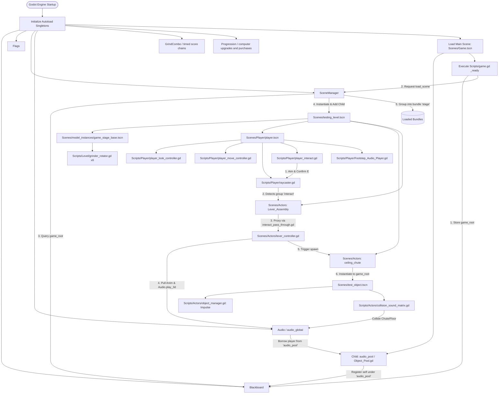

# Remnant GD

A modular, decoupled game architecture built on **Godot Engine 4.7 Forward+**, utilizing **Jolt Physics 3D** and **Direct3D 12**.

> [!TIP]
> **Interactive Documentation**: An offline-ready, searchable HTML wiki is available in [`.wiki/index.html`](.wiki/index.html). You can double-click it in your file explorer to open it immediately in any browser with instant search, dark/light theme toggle, and code copying.

---


## Reusable Blender workflow

The installed [blender-asset-workflow skill](Skills/blender-asset-workflow/SKILL.md) guides realistic environment and prop modelling for this and future projects. It requires finished textures/materials on every model, separate editable room and item assets assembled through links/instances, and at least three useful final Blender views with every image visually reviewed. Native sources, packed textures and requested separate exports are delivered together. Invoke it as `$blender-asset-workflow`; automatic discovery remains enabled.

Export/texture guidance and a Remnant-specific authoring reference live alongside the skill. Engine lighting, physics and gameplay integration follow the target project's own workflow. The repository copy is versioned; the matching user copy is installed under the user skills folder.

## Worn Blender apartment and furniture

The [studio apartment](Models/Architecture/StudioApartment/README.md) now has stained plaster, worn oak, aged trim and local damp/grease patches. Its newspaper-covered windows still have three physical sunlight seams. A separate kitchenette and all 17 requested furniture types have individual packed Blender sources and metre-scale GLBs under [Models/Interiors/StudioFurniture](Models/Interiors/StudioFurniture/README.md).

[studio_apartment_furnished.blend](Models/Interiors/FurnishedStudio/studio_apartment_furnished.blend) links the independent room plus 18 furniture assets. Room geometry and props remain separate. The full delivery has 54 actual Cycles prop renders (three views each) plus four furnished-room angles. [Phone gallery](https://remnant-development-summary.callmehaptic.chatgpt.site/StudioFurniture/index.html) · [Local gallery](Reports/StudioFurniture/index.html). This is a reusable art collection, not a new gameplay level; engine colliders/interaction/lighting need scene setup. The earlier [unfurnished gallery](Reports/StudioApartment/index.html) remains development history.

Authoring tools: make_studio_furniture_textures.py, model_studio_furniture.py, assemble_worn_studio.py and make_studio_gallery.py under Tools/. Portable/native verification tools are documented in the furniture README. All final renders are visually reviewed; native packed images/library links and Godot import are checked alongside the Windows release/startup delivery.

## Architecture Overview

Remnant GD is built around decoupled global services, reactive state management, audio pooling, physical interaction raycasting, and modular character/environment controllers:



---

## Directory Structure

```
Remnant-GD/
├── Global/                                # Engine-wide singletons and shared models
│   ├── Blackboard.gd                      # Global key-value registry and service locator
│   ├── flag.gd                            # Reactive boolean Resource with signals
│   ├── Flags.gd                           # Global flag state manager
│   ├── scene_def.gd                       # Scene metadata model & node_type enum
│   ├── scene_manager.gd                   # Dynamic scene instancer & bundle manager
│   ├── audio_global.gd                    # Global spatial and stereo pooled audio dispatcher
│   └── grind_combo.gd                     # Timed chain multiplier and batched score payout
├── Scenes/                                # Game scene definitions (.tscn)
│   ├── Game.tscn                          # Main root entry scene (hosts audio_pool)
│   ├── testing_level.tscn                 # 3D sandbox testing stage with lighting & fog
│   ├── audio_player.tscn                  # Pooled audio player prefab (3D + Global)
│   ├── test_object.tscn                   # Physics prop with impulse & collision sound matrix
│   ├── Actors/                            # Interactive actor prefabs
│   │   ├── lever_assembly.tscn            # Interactive lever machine with lights & animations
│   │   ├── lever_controller.gd            # FSM controller for lever mechanics
│   │   └── score_object.tscn              # Reusable child score-value component
│   ├── Player/                            # Player actor scenes
│   │   └── player.tscn                    # CharacterBody3D with camera, look, move, raycast, audio
│   ├── UI/                                # Reusable prompt_label.tscn styling
│   └── model_instances/                   # Pre-composed environment & prop instances
│       ├── game_stage_base.tscn           # Instanced FBX level geometry with 6 grinder rollers
│       ├── lever.tscn                     # Lever handle mesh instance wrapper
│       └── lever_base.tscn                # Lever chassis mesh instance wrapper
├── Scripts/                               # Gameplay and subsystem scripts
│   ├── game.gd                            # Root bootstrap controller attached to Game.tscn
│   ├── interact_pass_through.gd           # Interaction proxy forwarding raycast calls
│   ├── Object_Pool.gd                     # Generic PackedScene recycling object pool
│   ├── Actors/                            # Actor subsystem components
│   │   ├── audio_player.gd                # Pooled dual 3D/global audio stream player
│   │   ├── ceiling_chute.gd               # Overhead item spawner parenting to game_root
│   │   ├── CollisionSoundEntry.gd         # Resource definition mapping groups to audio
│   │   ├── collision_sound_matrix.gd      # Contextual physics impact sound evaluator
│   │   ├── object_manager.gd              # Impulse launcher for physical props
│   │   └── score_object.gd                # Configurable points on a child Node
│   ├── Level/                             # Environmental logic & interactive hazards
│   │   ├── grinder_rotator.gd             # Continuous angular rotation component
│   │   └── grinding_area.gd               # Dropped-item destruction and Blackboard scoring
│   ├── Building/                          # Recipes, packed items, and registered placed buildings
│   ├── UI/                                # Prompt entries/sets, object components, labels, and display
│   └── Player/                            # Player mechanics
│       ├── player_look_controller.gd      # Smooth mouse-look with pitch clamping & escaping
│       ├── player_move_controller.gd      # CharacterBody gravity, stair climbing and WASD sprint movement
│       ├── player_interact.gd             # Interaction input listener dispatching raycasts
│       ├── player_pickup.gd               # Pickup/drop, charged throwing, and item consumption
│       ├── raycaster.gd                   # Group-filtered 3D raycast targeting component
│       └── Footstep_Audio_Player.gd       # Positional 3D alternating footstep audio orchestrator
├── Data/                                  # Data-driven resources
│   ├── Prompts/                           # Editable look-at, carrying and rotation hint resources
│   └── Collision Sounds/                  # Material impact sound profiles (.tres)
│       ├── chute_sound_collisions.tres    # Whoosh audio profiles for chute collisions
│       └── object_hit_floor.tres          # Clunk/impact audio profiles for floor collisions
├── Audio/                                 # Audio clips and sound banks
│   └── SFX/
│       ├── machine_run.wav                # Ambient industrial machinery loop
│       ├── grind.wav                      # Roller hazard grinding audio
│       ├── Chute Impacts/                 # 6 cinematic metal whoosh sound samples
│       ├── Footsteps/                     # 23 footstep samples (Footstep_L1..12, R1..11)
│       ├── item_hit_floor/                # 7 metal clunk and impact samples
│       └── Lever/                         # Lever_Pull.wav and Lever_Reset.wav
├── Models/                                # 3D assets, textures, materials, and FBX meshes
│   ├── Chute/                             # Overhead ceiling chute FBX models
│   ├── Lever/                             # Lever arm and base FBX models
│   └── Level/                             # Stage geometry and PBR materials
├── default_bus_layout.tres                # Audio Bus routing (Master -> Game_Master [Reverb] -> SFX)
├── .wiki/                                 # Searchable offline HTML Wiki (hidden from Godot)
│   ├── .gdignore                          # Engine ignore file
│   └── index.html                         # Single-file documentation portal with search
├── guide.txt                              # Maintenance guide and running log for AI agents
├── project.godot                          # Godot 4.7 project configuration
└── README.md                              # Repository documentation
```

> [!NOTE]
> Active autoload singletons in `project.godot` point directly to canonical scripts in `Global/`: `Blackboard`, `Flags`, `SceneManager`, `Audio`, and `Buildings`. Duplicate script files in the repository root are legacy copies.

---

## Systems & Subsystems Reference

### 1. Globals (`Global/`)

#### Blackboard (`Global/Blackboard.gd`)
- **Autoload Singleton**: `Blackboard`
- **Class Name**: `blackboard`
- **Inherits**: `Node`
- **UID**: `uid://b0xpvnyknnyk0`

Centralized key-value storage and service locator. Eliminates direct scene couplings.

##### Methods
| Method | Return Type | Description |
|---|---|---|
| `store_data(key: String, data: Variant)` | `void` | Stores or overwrites a value under `key`. |
| `read_data(key: String)` | `Variant` | Retrieves value for `key`, or returns `null`. |
| `data_exists(key: String)` | `bool` | Returns `true` if `key` exists in the blackboard. |
| `return_set(subkey: String)` | `Dictionary` | Returns all key-value pairs whose keys begin with `subkey`. |
| `remove_data(key: String)` | `void` | Deletes the entry under `key`. |

##### Code Example
```gdscript
# Register a global service or pool
Blackboard.store_data("game_root", self)
Blackboard.store_data("audio_pool", audio_pool_instance)

# Read from another system
var game_root = Blackboard.read_data("game_root")
var pool = Blackboard.read_data("audio_pool")
```

---

#### flag (`Global/flag.gd`)
- **Class Name**: `flag`
- **Inherits**: `Resource`
- **UID**: `uid://iv0r7qmbcuf`

An individual reactive boolean state resource that emits signals when changed.

##### Properties & Signals
- `state: bool = false`: Current state.
- `signal flag_set`: Emitted when `state` becomes `true`.
- `signal flag_unset`: Emitted when `state` becomes `false`.
- `set_state(val: bool)`: Updates state and emits the corresponding transition signal.

---

#### Flags (`Global/Flags.gd`)
- **Autoload Singleton**: `Flags`
- **Class Name**: `flags`
- **Inherits**: `Node`
- **UID**: `uid://cmu2qskbjdauq`

Global manager for storing, querying, and observing named boolean flags.

##### Methods
| Method | Return Type | Description |
|---|---|---|
| `set_flag(key: String, state: bool = true, connection_set: Array[Callable] = [], connection_unset: Array[Callable] = [])` | `void` | Sets flag, connects callbacks, and emits transition signal. |
| `check_flag(key: String)` | `bool` | Checks state; returns `false` if flag does not exist. |
| `remove_flag(key: String)` | `void` | Erases flag from storage. |
| `connect_to_flag(key: String, connection_set: Array[Callable] = [], connection_unset: Array[Callable] = [])` | `void` | Attaches listener Callables to transitions. |

---

#### scene_def (`Global/scene_def.gd`)
- **Class Name**: `scene_def`
- **Inherits**: `Resource`
- **UID**: `uid://dc5037qix867v`

Metadata class representing a loaded scene instance tracked by `SceneManager`.

##### Properties
- `name: StringName`: Unique scene identifier.
- `node: Node`: Instantiated node in the tree.
- `type: node_type`: Classification enum (`ui = 0`, `actor = 1`).
- `asset: PackedScene`: Source scene asset.

---

#### SceneManager (`Global/scene_manager.gd`)
- **Autoload Singleton**: `SceneManager`
- **Inherits**: `Node`
- **UID**: `uid://b0kybwgisrflw`

Global orchestrator for dynamic scene instancing, bundle grouping, parent resolution, and memory cleanup.

##### Methods
| Method | Return Type | Description |
|---|---|---|
| `load_scene(scn: PackedScene, access_name: StringName, bundle: StringName = "", parent: Node = null)` | `Node` | Instantiates `scn`, mounts to `parent` (or `Blackboard["game_root"]`), and registers in bundle or scene dictionary. |
| `unload_scene(access_name: StringName)` | `void` | Invokes `queue_free()` and clears references. |
| `get_scene(access_name: StringName)` | `Node` | Returns active `Node` by name. |
| `scene_exists(access_name: StringName)` | `bool` | Returns `true` if scene is loaded. |

---

#### audio_global (`Global/audio_global.gd`)
- **Autoload Singleton**: `Audio`
- **Class Name**: `audio_global`
- **Inherits**: `Node`
- **UID**: `uid://6htl8d4x7ugw`

Global sound dispatcher managing spatial 3D audio and non-spatial stereo audio via pooled `audio_player` instances.

##### Static Methods
| Method | Return Type | Description |
|---|---|---|
| `play_3d(stream: AudioStream, position: Vector3, volume: float = 1.0, pitch: float = 1.0, bus: StringName = &"Master")` | `void` | Borrows an `audio_player` from `Blackboard["audio_pool"]`, positions it, sets parameters, and plays 3D spatial stream. Recycles on finish. |
| `play_global(stream: AudioStream, volume: float = 1.0, pitch: float = 1.0, bus: StringName = &"Master")` | `void` | Borrows an `audio_player` and plays stream via non-positional stereo player. Recycles on finish. |
| `_on_audio_finished(pool: object_pool, audio: audio_player)` | `void` | Callback that returns the player back to the pool via `pool.release_object(audio)`. |

##### Code Example
```gdscript
# Triggering spatial 3D sound via Autoload singleton
Audio.play_3d(pull_sound, global_position, 1.0, 1.0, "SFX")

# Triggering via static class name
audio_global.play_3d(footstep_sample, foot_position, 0.8, 1.0, "SFX")
```

---

### 2. Scripts Subsystems (`Scripts/`)

#### Root: `Scripts/`

##### `game.gd`
- **Inherits**: `Node`
- **UID**: `uid://b4onouqptgpob`
- **Description**: Bootstrap controller attached to `Scenes/Game.tscn`. Registers `self` into `Blackboard` under `"game_root"` and requests `SceneManager.load_scene("res://Scenes/testing_level.tscn", "test_level", "stage")`.

##### `interact_pass_through.gd`
- **Inherits**: `Node`
- **UID**: `uid://b327fegnr3cah`
- **Description**: Interaction proxy component. When attached to collision shapes (such as `StaticBody3D` in group `"interact"`), it receives `interact()` calls from the player's raycast and forwards them to a configured `target` node.
- **Exported Properties**:
  - `@export var target: Node`: Target node receiving forwarded `interact()` invocations.

##### `Object_Pool.gd`
- **Class Name**: `object_pool`
- **Inherits**: `Node`
- **UID**: `uid://d0spk0ca82aid`
- **Description**: High-performance generic object pooling container. Pre-instantiates and recycles reusable `PackedScene` instances, avoiding garbage collection spikes.
- **Exported Properties**:
  - `@export var pooled_scene: PackedScene`: Scene asset to instantiate and pool.
  - `@export var initial_size: int = 0`: Pre-spawned instance count on ready.
  - `@export var reset_method: StringName = &""`: Optional cleanup method called upon release.
  - `@export var register_with_blackboard: bool = false`: If true, stores self in `Blackboard`.
  - `@export var blackboard_name: StringName = &""`: Key name for Blackboard storage.
- **Methods**:
  - `get_object() -> Node`: Pops available instance or creates a new one.
  - `release_object(object: Node) -> void`: Executes reset method and returns instance to pool.

---

#### Subfolder: `Scripts/Actors/`

##### `audio_player.gd`
- **Class Name**: `audio_player`
- **Inherits**: `Node3D`
- **UID**: `uid://jnf7npi534wc`
- **Description**: Pooled audio entity combining an `AudioStreamPlayer3D` and an `AudioStreamPlayer`.
- **Exported Properties**:
  - `@export var audio_3d: AudioStreamPlayer3D`: Positional 3D player.
  - `@export var audio_global: AudioStreamPlayer`: Non-positional stereo player.
- **Signals**: `playback_finished`
- **Methods**: `play_3d(...)`, `play_global(...)`, `stop()`, `reset()`.

##### `ceiling_chute.gd`
- **Class Name**: `ceiling_chute`
- **Inherits**: `Node3D`
- **UID**: `uid://di3swkqh5sn4a`
- **Description**: Overhead industrial chute spawner. Chooses a random scene from `item_pool` (default pool currently contains `test_object.tscn`) and parents it to `Blackboard["game_root"]` at `spawn_point.global_position`.
- **Exported Properties**:
  - `@export var spawn_point: Node3D`: Spawn marker transform.
  - `@export var item_pool: item_spawn_pool`: Editable pool of physical item scenes.

##### `CollisionSoundEntry.gd`
- **Class Name**: `collision_sound_entry`
- **Inherits**: `Resource`
- **UID**: `uid://ntd28sbuhvl7`
- **Description**: Data resource pairing target collision group names with sound banks and volume levels.
- **Exported Properties**:
  - `@export var name: StringName`: Identifier name.
  - `@export var group: StringName`: Target collision group name (e.g. `Chute`, `Floor`).
  - `@export_range(0.0, 1.0, 0.01) var volume: float = 1.0`: Volume scalar.
  - `@export var sounds: Array[AudioStream]`: Bank of randomized audio clips.

##### `collision_sound_matrix.gd`
- **Class Name**: `collision_sound_matrix`
- **Inherits**: `Node3D`
- **UID**: `uid://charfnmvsr4so`
- **Description**: Physics collision sound evaluator. When connected to `body_entered(other)`, it checks `other` against the configured `sound_matrix` array of `collision_sound_entry` resources and triggers 3D audio via `audio_global.play_3d()`.
- **Exported Properties**:
  - `@export var sound_matrix: Array[collision_sound_entry]`: Collection of collision sound profiles.

##### `object_manager.gd`
- **Class Name**: `object_manager`
- **Inherits**: `Node3D`
- **UID**: `uid://casxr53xeio0n`
- **Description**: Physics prop launch controller. During `_ready()`, applies a randomized 3D impulse scaled by `start_force` to its child `RigidBody3D`.
- **Exported Properties**:
  - `@export var rb: RigidBody3D`: Target rigid body.
  - `@export var start_force: float = 10.0`: Impulse magnitude.

##### `lever_controller.gd` (`Scenes/Actors/lever_controller.gd`)
- **Class Name**: `lever`
- **Inherits**: `Node3D`
- **UID**: `uid://hu82hspe070x`
- **Description**: FSM controller managing interactive lever mechanics (`0 = idle`, `1 = pull`, `2 = reset`), status indicator lights, animation tracks, 3D audio, and chute spawn triggers.
- **Exported Properties**:
  - `@export var anim: AnimationPlayer`: Animation player for lever rotation tracks.
  - `@export var chute: ceiling_chute`: Target chute triggered upon pull completion.
  - `@export var pull_sound: AudioStream`: Audio stream for lever pulling.
  - `@export var reset_sound: AudioStream`: Audio stream for lever resetting.
  - `@export var green_light: OmniLight3D`: Standby ready light (energy 1 when idle).
  - `@export var red_light: OmniLight3D`: Active cycle light (energy 1 when busy).

---

#### Subfolder: `Scripts/Level/`

##### `grinder_rotator.gd`
- **Inherits**: `Node3D`
- **UID**: `uid://bnrtinfng5v8l`
- **Description**: Continuous angular rotation component for rotating hazard rollers in `game_stage_base.tscn`.
- **Exported Properties**:
  - `@export var roation_speed: Vector3 = Vector3(0, 0, 0)`: Euler rotation velocity in deg/sec.

---

#### Subfolder: `Scripts/Player/`

##### `player_look_controller.gd`
- **Inherits**: `Node`
- **UID**: `uid://bu180f6gx5iet`
- **Description**: First-person mouse-look controller with separate head pitch and body yaw pivots, exponential smoothing, and pitch clamping.
- **Exported Properties**:
  - `Head: Node3D`: Camera pivot for pitch (X-axis).
  - `Body: Node3D`: Character body pivot for yaw (Y-axis).
  - `sensitivity: Vector2 = Vector2(0.08, 0.08)`: Mouse sensitivity factors.
  - `smoothness: float = 18.0`: Exponential lerp speed coefficient.
  - `clamp_look: Vector2 = Vector2(-89.0, 89.0)`: Min/max vertical pitch clamping.
  - `quit_key: Key = Key.KEY_ESCAPE`: Releases mouse capture to `MOUSE_MODE_VISIBLE`.

##### `player_move_controller.gd`
- **Inherits**: `Node`
- **UID**: `uid://bk5h65t12flbr`
- **Description**: CharacterBody WASD locomotion, gravity and stair-climbing controller. Computes direction relative to body orientation, manages acceleration and deceleration smoothing, scales by sprint multiplier, runs `move_and_slide()`, and drives the footstep sound player cadence.
- **Exported Properties**:
  - `move_speed: float = 10.0` (configured in player.tscn as `2.5`).
  - `sprint_speed_mult: float = 2.0`: Speed multiplier when holding `sprint` action.
  - `acceleration: float = 40.0`: Acceleration rate.
  - `deceleration: float = 40.0`: Deceleration rate.
  - `body: Node3D`: Body node providing forward/right basis.
  - `character_body: CharacterBody3D`: Target player CharacterBody3D.
  - `footstep_player: footstep_audio`: Reference to footstep player component.

##### `player_interact.gd`
- **Class Name**: `player_interact`
- **Inherits**: `Node`
- **UID**: `uid://dhx0pwxpcthco`
- **Description**: Player interaction dispatcher. Listens for the `confirm` input action (E key release), checks if `raycaster` is aiming at a valid target, and invokes `interact()` on that target.
- **Exported Properties**:
  - `@export var ray: raycaster`: Reference to camera raycaster.

##### `raycaster.gd`
- **Class Name**: `raycaster`
- **Inherits**: `RayCast3D`
- **UID**: `uid://dopt5ybemmifn`
- **Description**: Group-filtered first-person RayCast3D targeting system. Tracks hovered target nodes within reachable distance that belong to whitelisted groups (e.g. `&"interact"`).
- **Exported Properties**:
  - `@export var ray_distance: float = 3.0`: Maximum reach distance in meters.
  - `@export var target_groups: Array[StringName] = []`: Whitelisted group names.

##### `Footstep_Audio_Player.gd`
- **Class Name**: `footstep_audio`
- **Inherits**: `Node3D`
- **UID**: `uid://dnnbhrne61at7`
- **Description**: Timer-driven alternating positional 3D footstep sound orchestrator. Dispatches audio clips via `audio_global.play_3d()` and supports walk and sprint pacing intervals.
- **Exported Properties**:
  - `right_foot_sounds: Array[AudioStream]`: 11 right foot audio streams.
  - `left_foot_sounds: Array[AudioStream]`: 12 left foot audio streams.
  - `left_player: Node3D`: Left foot marker transform (offset x = -0.88m).
  - `right_player: Node3D`: Right foot marker transform (offset x = +0.47m).
  - `footstep_timer: Timer`: Cadence timer.
  - `sprint_timer: float = 0.25`: Cadence interval while sprinting.
  - `walk_timer: float = 0.5`: Cadence interval while walking.
  - `volume: float = 1.0`, `pitch: float = 1.0`, `bus: StringName = &"Master"`.
  - `enabled: bool = false`: Playback active toggle.

---

### 3. Scenes Reference (`Scenes/`)

- **`Scenes/Game.tscn`** (`uid://dcrox1fn8bvwe`):
  - Root node running `Scripts/game.gd`.
  - Child node `audio_pool` running `Scripts/Object_Pool.gd`, registered to Blackboard as `"audio_pool"`.
- **`Scenes/testing_level.tscn`** (`uid://blbs2kyd6bds2`):
  - 3D test stage featuring `WorldEnvironment` (SSAO + Volumetric Fog density 0.0634).
  - Ambient 3D audio `MachineRun` on SFX bus.
  - Instantiates `game_stage_base.tscn`, `player.tscn`, `ceiling_chute`, and `Lever_Assembly`.
- **`Scenes/Player/player.tscn`** (`uid://ci3oy7ni8sysi`):
  - `CharacterBody3D` with `CapsuleShape3D` collider.
  - `Camera3D` equipped with `SpotLight3D` flashlight and `RayCast3D` running `raycaster.gd`.
  - `footstep_sound_players` running `Footstep_Audio_Player.gd` with 23 footstep streams.
  - `Controllers` node housing `Player_Look_Controller`, `Player_Move_Controller`, and `Player_Interact`.
- **`Scenes/model_instances/game_stage_base.tscn`** (`uid://da63abf1yef55`):
  - Instanced from `Models/Level/game_stage_base.fbx`.
  - Configures 6 rotating grinder rollers with alternating rotation speeds (`-25` and `+25` deg/s) running `grinder_rotator.gd`.
- **`Scenes/Actors/lever_assembly.tscn`** (`uid://x4o8rin8xvjo`):
  - Complete interactive lever apparatus with FBX model meshes, green/red status indicator lights, `AnimationPlayer`, and a `StaticBody3D` collision volume running `interact_pass_through.gd` in group `"interact"`.
- **`Scenes/audio_player.tscn`** (`uid://drn170duudujd`):
  - Pooled audio emitter entity running `audio_player.gd`, housing an `AudioStreamPlayer3D` and an `AudioStreamPlayer`.
- **`Scenes/test_object.tscn`** (`uid://0851ilsmei5g`):
  - Interactive physics prop spawned by the ceiling chute. Runs `object_manager.gd` on root and `collision_sound_matrix.gd` on child `RigidBody3D` with continuous collision detection and chute/floor audio profiles.

---

### 4. Audio Routing Architecture & Data Profiles

#### Audio Bus Hierarchy (`default_bus_layout.tres`)
1. **`Master` (Bus 0)**: Direct output to physical hardware speakers.
2. **`Game_Master` (Bus 1)**: Routes into `Master`. Contains an active `AudioEffectReverb` effect applying room resonance to the entire scene.
3. **`SFX` (Bus 2)**: Routes into `Game_Master`. Carries all sound effects (footsteps, machines, levers, collisions), naturally receiving environmental reverb.

#### Data Profiles (`Data/Collision Sounds/`)
- **`chute_sound_collisions.tres`** (`uid://ca8v04uj6idly`): `collision_sound_entry` for group `&"Chute"` at volume `0.5`, containing 6 cinematic metal whoosh sound samples.
- **`object_hit_floor.tres`** (`uid://cemrs3dv756c8`): `collision_sound_entry` for group `&"Floor"` at volume `1.0`, containing 7 metal clunk and impact sound samples.

---

## Manual props and timed grinding combos

Run `Scenes/Game.tscn`. The testing level provides two loose fans, two loose flat steel plates and a basket. Pull the lever with E to spawn scored items, then manually guide or carry them into the grinder. Fan/plate scenes are RigidBody3D props using their visible art directly. The plate is a 2.4×2.4×0.12 m sheet with one matching collider and no T base. Fans keep their housing, stand, wind sensor and airflow particles.

F picks up/drops, RMB charges/throws, wheel rotates held fans/plates by 15°, and R cycles Y→Z→X axes. Pickup preserves the item's orientation relative to the camera and carries a composed orthonormal rotation. Solid carried colliders are disabled; the fan Wind sensor remains active. Fans blow loose physical objects along local -Z while held or loose. They push the CharacterBody player only when unheld, using independent wind velocity that survives normal movement deceleration. Wind decays after leaving airflow.

Every ground item starts/extends a shared chain. First item: 1.0× and 3 seconds. Each next item adds 0.5× and refills a window shorter by 0.4 seconds, down to 0.5 seconds. Scoring items contribute their score_object value, default 1; unscored destroyed items advance the chain with zero base value. On expiry, round(sum of base values × final multiplier) is queued for accelerating one-point Blackboard score awards. Two 10-point items earn 30 points at 1.5×. A new chain resets multiplier and window. Grind.wav plays for each item; Score.wav plays loudly on SFX for each queued score award.

Reusable Scenes/UI/combo_display.tscn pops up at the top centre with multiplier, item count, pending score, countdown text. The display has no background or bar. Expiry shows the banked points for two seconds. Labels/styles are editable in the scene.

Baskets keep real contained bodies, preserve their original wrapper/value, and restore physics on drop/throw/empty. F drops, RMB throws and E empties. Containment uses full collider bounds with 0.025 m contact tolerance. Fan, plate and basket are machine-immune: the grinder rejects them. physics_items.gd now lives in Scripts/Actors.

Removed runtime: Buildings registry, ScoreRewards queue, packed crates, recipes, build sockets, automators, bounce pads, processors, conveyors, splitters, bursts, hoppers, platforms, stairs, editable building signs, and machine_sandbox. Original imported source art is retained as unused art. The ordinary manual lever, test item, score sign, audio pool and dynamic prompts remain.

### GrindCombo API

| Metadata | Value |
|---|---|
| File | Global/grind_combo.gd |
| Class / inheritance | No class_name / Node |
| UID | uid://b2vhko1kxul63 |
| Autoload | GrindCombo |

Exports: initial_window: float=3, window_decrease: float=0.4, minimum_window: float=0.5, multiplier_step: float=0.5, score_sound: AudioStream=Score.wav, score_volume: float=2. Runtime: item_count/base_points: int, remaining/current_window: float. Signals: combo_changed(), combo_paid(points: int, multiplier: float, items: int).

| Method | Behavior |
|---|---|
| record_item(points: int) -> void | Counts a destroyed item, adds nonnegative base value, boosts multiplier and refills the shortened window. |
| multiplier() -> float | 1 + item_count × nonnegative multiplier_step. |
| pending_points() -> int | Rounded base_points × multiplier. |
| _process(delta: float) -> void | Advances countdown and pays at expiry. |
| finish_combo() -> void | Banks once, resets, plays pooled score sound and emits payout. |
| reset() -> void | Clears pending chain without payment; game bootstrap calls this before loading the level. |

### Loose fan, plate and shared physics

| File | Class / inheritance | UID | Autoload |
|---|---|---|---|
| Scripts/Actors/rotatable_item.gd | rotatable_item / RigidBody3D | uid://dc3n6qssprqkg | None |
| Scripts/Actors/fan.gd | No class_name / rotatable_item | uid://ixf0wp2jrttr | None |
| Scripts/Actors/physics_items.gd | physics_items / RefCounted | uid://cc4hgy4crenub | None |

rotatable_item exports carry_prompts: prompt_set and rotation_step: float=15. State: held: bool, rotation_axis: int=1, held_rotation: Basis. APIs: on_picked_up()/on_released(), get_carry_prompts() -> prompt_set, get_hold_offset() -> Vector3, get_hold_rotation() -> Basis, get_rotation_axis_name() -> String, cycle_rotation_axis(), rotate_held(direction: float). No custom signals.

fan exports force: float=18, maximum_speed: float=12, player_acceleration: float=22. _physics_process(delta) reads Wind overlaps, accelerates loose rigid bodies and sends unheld player wind to Controllers/Player_Move_Controller. on_held_transform_updated() keeps Wind.collision_mask=1 after solid pickup collision disabling. Direction is -global_basis.z. Held fans skip players; reusable tools remain physical wind targets. A low custom centre of mass stabilizes its stand.

physics_items APIs: rigid_body(node) resolves enclosing RigidBody3D while rejecting characters; is_loose(body) checks live/unfrozen; is_processable(body) also requires in-tree and no machine-immune group on body/logical root. item_root(body) resolves score/grindable wrappers; score_component(node) finds a score_object; collider_states(node) stores weak collision snapshots; set_collisions(states, enabled) restores them; support_extent(body, axis) measures active collider bounds.

Scenes/Actors/fan.tscn and steel_plate.tscn are actual pick-up/machine-immune RigidBody3D props, with reusable pickup/carrying prompt resources. No packing, recipes, ghost or save registry is involved.

### combo_display.gd and reusable popup

| Metadata | Value |
|---|---|
| File | Scripts/UI/combo_display.gd |
| Class / inheritance | No class_name / CanvasLayer |
| UID | uid://b8xldoix6nde3 |
| Scene | Scenes/UI/combo_display.tscn |
| Autoload | None |

Export payout_display_time: float=2. Runtime payout_time, pulse: float and last_count: int. _ready() connects GrindCombo signals; refresh() shows current multiplier/value/count/time, resetting pulse for each item; _show_payout(points, multiplier, items) shows the full banked amount and hides timer bar; _process(delta) animates pulse and dismisses payout. No custom signals. Preserve Position/Panel/Rows and child Title/Points/Countdown/Time paths. CanvasLayer layer 5 is wired into the testing level. Panel and bar ignore mouse input.

### Pickup, movement and dynamic prompts

player_pickup.gd keeps F drop/pickup, charged RMB throw, collision snapshots and container hooks. _unhandled_input(event) handles wheel and R only for held rotatable_item objects. _update_held_object(delta) composes the hold marker basis with get_hold_rotation() before smoothing, then calls on_held_transform_updated() when provided. The building reference, placement cancellation and package/query helper APIs were removed.

player_move_controller.gd exports wind_drag: float=3, with wind_velocity/applied_wind: Vector3. apply_wind(direction: Vector3, force: float, maximum_speed: float, delta: float) accumulates capped wind separately from walking. _physics_process subtracts the last applied wind from locomotion before adding current wind, retains gravity and disables floor snapping during upward wind. Gravity and ordinary stepping remain.

object_prompts.get_prompts() returns only its configured prompt_set; recipe fallback is removed. prompt_display has ray/pickup references, label_scene and carrying_prompts. Held-object get_carry_prompts() overrides ordinary carrying; otherwise look-at providers apply. Rotatable props append a live [R] Axis hint. The player/level have no building controller. Raycast debugging is off. Reusable prompt labels, key rebinding and ancestor provider resolution remain supported.

### basket.gd

| Metadata | Value |
|---|---|
| File | Scripts/Actors/basket.gd |
| Class / inheritance | No class_name / RigidBody3D |
| UID | uid://broq62geh48lm |
| Autoload | None |

Exports carry_prompts: prompt_set, containment_tolerance: float=0.025. State contents: Array[Dictionary] (weak body, local pose, original freeze/mode, collider snapshot and extent), carried: bool, last_carry_pose: Transform3D. Bounds x ±0.7, y 0.15..1.1, z ±0.6, with tolerance for small contact penetrations. Fully outside/rim-intersecting items are excluded.

contained_bodies() -> Array[RigidBody3D] finds contained loose eligible bodies. on_picked_up() captures, freezes and disables item collisions; on_held_transform_updated() follows immediately and releases externally removed bodies; _physics_process also synchronizes. on_released() synchronizes then restores collisions/freeze and inherits basket velocity. empty_contents()/interact() release all with size-aware spacing and outward velocity. get_carry_prompts() supplies F/RMB/E hints, get_hold_offset() provides carry offset, _exit_tree() restores survivors. No custom signals. Basket belongs to pick-up/interact/machine-immune.

### Grinding and score components

Scripts/Level/grinding_area.gd (grinding_area / Area3D, UID uid://bcxrh405f124t, no autoload) exports grind_sound=grind.wav and grind_volume=1. grind(body: Node3D) -> bool accepts loose processable items, rejects reusable tools/characters/scenery, resolves score/grindable wrappers and guards duplicate callbacks. Each accepted item calls GrindCombo.record_item(value), plays pooled SFX and destroys the complete wrapper. score_object child value overrides default 1 only when the item has the score group; non-scoring items add zero base value but advance the chain.

Scripts/Actors/score_object.gd remains the child score-value component, with editable score: int. Scenes/Actors/score_object.tscn is reusable. score_sign.gd keeps left-aligned, leading-zero Blackboard score display; combo payment updates it once. Existing eighteen-digit default and configurable minimum_digits remain.

### Active scenes and regression coverage

Scenes/Game.tscn hosts the audio pool and loads Scenes/testing_level.tscn. The level includes the player, chute/manual lever, grinder, score sign, ordinary prompt display, loose fan/plate props, basket and ComboDisplay. There is no machine sandbox or stock-refill rack. Fans, restored lights and plates support B/B/F ghost placement on any solid surface; Q retrieves placed props without crates.

Tests/grind_combo_test.tscn checks live countdown/refill/minimum, 0.5 boosts, full payout exactly once, reset, real expiry, pooled loud SFX and popup visibility/content. Tests/grinding_system_test.tscn checks Area entry, score fallback/wrappers, duplicate callbacks, tool immunity and deferred combo payment. Tests/manual_props_test.tscn checks actual player displacement, held-player suppression, live held fan sensor, wheel/R rotation, directional loose-item wind, flat sheet collision and real settled basket capture/carry/empty. Tests/prompt_system_test.tscn checks actual level wiring, live axis hints, label reuse, overrides and rebinding. Tests/score_sign_test.tscn checks score formatting. All five suites pass and the Godot editor import reports no errors.

## Agent Maintenance Protocol

For future AI agents modifying this repository:
1. Always keep the interactive HTML wiki at [`.wiki/index.html`](.wiki/index.html) synchronized with codebase changes.
2. Ensure the top category in the wiki navigation remains **Globals**, followed by subcategories corresponding to subfolders in `Scripts/` (such as `Actors`, `Level`, `Player`).
3. Keep the wiki 100% self-contained (no external CDN dependencies).
4. Update `README.md` to reflect new or modified systems.
5. Append every change to the running log in [`guide.txt`](guide.txt) using the format:
   `[YYYY-MM-DD][HH:MM:SS] - updated the guide to include '<script_or_feature>'`


## Prop placement update

Fans, restored lights and flat plates use B to enter ghost placement, B to place and F to cancel. Wheel rotates and R cycles local axes in both carrying and placement. Any solid surface is accepted: floors, walls, ceilings and physical props. Placed tools stay fixed relative to their support and can be picked up again with F. No crates are involved. Scripts/Player/prop_placement.gd (prop_placement / Node) owns ray, clearance, ghost and support placement. Held rotation now composes around the item local axis and applies the target basis directly to avoid multi-axis smoothing drift. Combo UI uses a compact black/white square panel, left-aligned type and a thin square countdown bar without scaling animation.


Placement API: Scripts/Player/prop_placement.gd (class prop_placement, Node; UID uid://djmqfnex7by5r; no autoload/signals) exports pickup: player_pickup, camera: Camera3D and reach: float=6. State includes preview: Node3D, shapes: Array[Dictionary], placement_valid: bool, host: Node3D, item: rotatable_item and ghost material. is_building() -> bool, start_building() -> bool, try_build() -> bool and cancel_building() -> void implement B/B/F; Q retrieves a placed prop directly into the hand. _prepare() strips ghost scripts/groups/collision/light/particle behavior; _update_preview() raycasts any solid layer-1 surface, offsets full collider bounds outside it and checks unrelated obstacles. rotatable_item adds placed, support WeakRef and support_pose; place_on(host) fixes the prop to its support, and _physics_process follows it or releases physics when it disappears. Picking up clears support and restores loose-drop behavior. Imported static colliders are disabled so the root rigid collider owns prop physics. Fan calls the support update before applying wind and suppresses invisible ghost-mode wind. Tests/prop_placement_test.tscn verifies all three props on floor/wall/ceiling, local-axis invariance, cancellation, support movement/removal and repickup. Existing wind, combo, prompt, grinding and score tests remain active.

## Text-only combos, bottom-empty basket and manual tools

Combo UI now draws only white text: multiplier, item count/pending points and countdown, followed by earned total. No background, border or timer bar. The first item is 1.0×; the second is 1.5×; each further item adds 0.5×. The refilled window shrinks from 3 seconds by 0.4 seconds per item to a 0.5-second minimum. When the timer expires, the earned total joins ScoreRewards; it does not instantly change the score by the entire amount.

ScoreRewards awards the first point immediately, then waits 0.5 seconds. Each subsequent point reduces the interval by 0.02 seconds. New payouts extend the active queue without resetting its speed. If the interval reaches zero or below, all remaining queued score is awarded together, and speed resets. Score.wav plays loudly through pooled SFX for each award. Grinding still plays Grind.wav per destroyed item. The score sign updates from the actual counting Blackboard score.

E Empty releases basket items at their current positions with zero velocity/angular velocity. Temporary collision exceptions let them fall through the basket bottom under gravity; no forward/upward force, repositioning or spreading is added. Original collider/freeze settings and item wrappers remain intact. Exceptions clear when items leave beneath or beside the basket, or on basket deletion. Carrying still keeps the basket held after emptying.

Push broom: F equips/puts down and LMB pushes. It cannot be thrown, rotated or built. The head stays on the ground in front of the player, facing the player's horizontal view. A 0.45-second stroke extends forward 0.8 m and returns. A wide Sweep sensor pushes multiple loose eligible items, capped at 7.5 m/s. Ground probing ignores loose rigid bodies so item piles do not lift the broom. Broom is machine-immune and the grinder rejects it.

Upgraded fan and upgraded steel plate keep ordinary wheel/R holding controls. One V press immediately freezes the original prop at its exact current global position/rotation, without a ghost, ray or support. They remain suspended in the air and can be retrieved with F/Q; dropping a retrieved upgrade restores physics. Ordinary fans, lights and plates keep B ghost / B place / F cancel. Upgrades have distinct pickup/carrying prompts and Fan+/Plate+ labels. The saved testing level adds a broom and both upgrades without restoring props removed from the user's layout.

### ScoreRewards

| Metadata | Value |
|---|---|
| File | Global/score_rewards.gd |
| Class / inheritance | No class_name / Node |
| UID | uid://vpq007m5fks6 |
| Autoload | ScoreRewards |

Exports score_sound: AudioStream=Score.wav, score_volume: float=2, point_interval: float=0.5, interval_decrease: float=0.02. Runtime pending_points: int, current_interval/remaining: float. No custom signals. enqueue(points: int) -> void extends queue and starts only when idle; _process(delta) waits/decreases interval; _award() updates Blackboard score and pooled SFX; reset() clears queue and restores base interval. Game bootstrap resets both combo and queue. GrindCombo.multiplier() now uses max(item_count-1,0); finish_combo() queues pending_points and emits combo_paid for earned-total UI. Sound settings live on ScoreRewards rather than GrindCombo.

### push_broom.gd and air upgrades

| Metadata | Value |
|---|---|
| File | Scripts/Actors/push_broom.gd |
| Class / inheritance | No class_name / RigidBody3D |
| UID | uid://r4obti7uqlw6 |
| Autoload / signals | None |
| Scene | Scenes/Actors/push_broom.tscn |

Exports carry_prompts: prompt_set, hold_distance: float=1.5, stroke_distance: float=0.8, push_acceleration: float=52.5, maximum_speed: float=7.5. State held: bool, stroke_time: float and direction: Vector3. can_throw() -> bool returns false; get_carry_prompts() supplies F Put Down / LMB Push. on_picked_up()/on_released() change held state; release disables Sweep. push() starts a stroke only when held/idle. _unhandled_input(event) consumes LMB push while held. update_equipped_pose(player: PhysicsBody3D, marker: Node3D, delta: float) raycasts the ground and animates head travel; _physics_process(delta) accelerates eligible bodies in Sweep during the forward stroke.

player_pickup calls update_equipped_pose before ordinary carrying movement for items supplying that hook. can_throw guards both charging and direct throw_object. Broom is a normal pickup RigidBody3D with solid Head and Handle art, bottom bristles and a 1.8×0.6×1.0 m Sweep sensor; sensor works while held despite disabled solid collisions.

rotatable_item exports air_placeable: bool=false. place_on(null) fixes an upgraded prop without a support; its physics update retains that pose. prop_placement.place_in_air() -> bool preserves current global_transform, releases pickup collision state and locks the original item. V input selects this path only for air_placeable props; B retains normal ghost placement. Scenes/Actors/upgraded_fan.tscn and upgraded_steel_plate.tscn inherit their standard art/physics and set the flag, carrying_air_prop and distinct pickup prompt resources. Standard surface placement remains unchanged.

### Validation

Tests/manual_expansion_test.tscn checks queue timing, .02 acceleration, extension without instant payment, terminal flush/reset, two gravity-settled basket items dropping without launch/repositioning, temporary collision cleanup, exact one-press air pose and retrieval, grounded broom sweeping multiple bodies, and throw/build rejection. Grind combo test now verifies first 1.0×/second 1.5×, text-only presentation and deferred point counting. Grinding integration drains the queue for correct final score. Prompt test creates its own fan fixture, preserving user scene edits. Existing manual_props, prop_placement and score_sign suites remain active: seven total suites.

## Carry assemblies, transparency and upgraded placement

Broom push_acceleration is now 52.5 (was 35) and maximum_speed is 7.5 (was 5): both are 50% stronger. F/LMB controls remain unchanged.

player_pickup exports held_transparency: float=0.35. GeometryInstance3D transparency is applied per instance to held geometry, basket contents and attached props, preserving original values and shared materials. Existing transparency composes multiplicatively (0.1 becomes 0.415). Release restores original rendering; emptied basket items stop fading on the next carry update.

Placed props are tracked through the placed-prop group. rotatable_item.is_supported_by(root: Node3D) -> bool follows weak support/ancestor chains with cycle protection; sync_support_pose() -> void follows supports without applying fan forces. Pickup collects direct/nested attached props, snapshots their collider states and disables their solid physics while carried. carry metadata suppresses attached-fan player wind while retaining Wind sensing for loose items. Original layers/masks and opacity return on drop/throw; attachments stay mounted/frozen. Collision exceptions prevent mounted props fighting their own physical support and are removed when that prop is picked up. Freed held roots restore surviving attachments; detached or emptied assemblies shed temporary carry state.

New player_pickup runtime held_visual_state: Array[Dictionary] stores weak geometry/owner plus original transparency; held_attachments: Array[WeakRef] stores supported props. _set_carry_visuals(), _refresh_carry_visuals(), _belongs_to_carry(), _sync_attachments() and _restore_carry_state() manage the lifecycle. basket.get_carried_bodies() -> Array[RigidBody3D] exposes live contained bodies for carry presentation and attached-prop resolution.

Upgraded fans/plates now have both placement modes: B enters the normal ghost, B places, F cancels; V (place_in_air InputMap action) locks the original prop at its exact held position and rotation without support. V also works while previewing. Wheel/R rotation remains. carrying_air_prop.tres and ghost HUD show Build plus Lock In Air hints. Ordinary props do not accept V.

Tests/carry_attachment_test.tscn uses a Node runner (Tests/carry_attachment_test.gd, no class_name/autoload) to check basket→light→fan collider disabling, immediate support following, 35% fade/material preservation and exact restoration. It validates both B/B surface placement and V air placement for both upgrades and their opacity restoration. manual_expansion_test now uses V for its air-lock assertions. Eight active suites cover current behavior.

## Bottom anchors and rotation restoration

Scripts/Player/prop_placement.gd (class prop_placement, Node, existing UID) starts every fan/light/plate ghost with held_rotation Basis.IDENTITY and Y axis. Surface alignment maps local UP to the hit normal; collider minimum projection places the bottom against the surface, including walls/ceilings. Build-time wheel/R rotations affect the preview. Runtime carry_rotation: Basis and carry_axis: int preserve the previous carried orientation and selected axis. cancel_building restores both and the actual held basis immediately; successful placement commits the preview pose. V during an upgraded ghost locks the original carried pose, not the temporary anchor orientation. B/B/F and V controls are unchanged.

Tests/prop_placement_test.tscn now checks angled carry → upright bottom ghost → exact angle/axis restoration for fan, plate and light. Tests/carry_attachment_test.tscn also checks V from a rotated ghost preserves the carried pose.

## Animated start room door

Scripts/Actors/start_room_door.gd: class start_room_door extends Node3D, UID uid://cwwtf2o6xs7l3, no autoload. Attached directly to testing_level/doorway_animated (Models/Door/source/doorway_animated.glb); the door remains a sibling of the disposable room.

Exports open_animation: StringName=4_open_left and close_animation: StringName=4_close_left. Runtime is_open: bool, animation: AnimationPlayer, prompt_component: object_prompts. Signal opened fires when opening begins. interact() toggles open/close, ignoring repeated interaction while the animation is playing. _ready creates mesh triangle collisions which follow the imported hinge animation, registers the interact group and creates a reusable object_prompts/prompt_set/prompt_entry component. Dynamic prompts read Open Door [E] or Close Door [E] through the existing confirm action. No new player input or interaction path.

Imported 0_idle_closed establishes the initial pose; the authored two-second open/close animations move the physical door clear of the doorway. The door stays interactive after room removal.

## Start room visibility and exit flag

Scripts/Level/start_room.gd: class start_room extends CSGCombiner3D, UID uid://4io3wicvj051, no autoload. Exports door: start_room_door, player: CharacterBody3D, camera: Camera3D, interior: CSGBox3D, darkness_threshold: float=0.015, unseen_delay: float=0.2, visibility_check_interval: float=0.1. Runtime exit_armed: bool, unseen_time: float, visibility_elapsed: float, erased: bool. Signal room_erased fires once. Public is_room_visible() -> bool returns conservative visibility of room OR door.

Scene dependencies: testing_level/CSGCombiner3D has collision enabled and references the existing player/camera, sibling doorway_animated and Start_Room_Inner. A subtractive DoorOpening CSG box matches the mesh passage. Existing outer/inner room geometry, player spawn and light layout are preserved.

Opening arms exit tracking. A player inside the interior bounds plus 0.35 m safety margin cannot trigger removal. Outside, visibility samples a 13x9 screen grid and actual CSG/door triangle surfaces, using camera frustum and collision rays with the player excluded. Partial visible door/room protects the room; foreground occlusion counts as unseen. Darkness is conservatively estimated from ambient, directional, omni, spot and area lights, their shadows, and exponential fog distance attenuation; it is not a rendered-pixel brightness measurement. The configurable threshold can be tuned for art/material/exposure changes. Keeping a visible light or flashlight on the room keeps it present.

When both room and door are unseen continuously for 0.2 seconds, only CSGCombiner3D (including room light and collision) is queued for deletion. doorway_animated is retained and stays usable. Flags.set_flag("exited room", true) is set exactly at removal. A previously set flag skips recreating the room on scene load, retaining the door. This integrates with existing Flags; disk serialization remains future work.

Tests/start_room_test.gd and .tscn (Node runner, no class/autoload) verify E prompt/ray targeting, closed/open collision, unobstructed doorway, inside protection, visible look-back, turn-away removal, darkness, retained door and existing flag loading. Other placement/carry/prompt/manual expansion tests cover integration.

## Start room audio and footstep overrides

Scripts/Level/start_room.gd (start_room, CSGCombiner3D, UID uid://4io3wicvj051) adds Room Audio exports footsteps: footstep_audio, left_foot_sounds/right_foot_sounds: Array[AudioStream] (empty until authored), mute_sfx_until_open: bool=true. testing_level/CSGCombiner3D references Player/footstep_sound_players. Assign room sound lists directly on CSGCombiner3D in the inspector. Interior bounds plus 0.1 m tolerance select room footsteps; outside restores normal footsteps, including when stepping out then reentering. Empty banks fall back independently to the player's normal left/right banks.

On ready, unless Flags[exited room] is already true, room snapshots SFX volume and mute preference, sets its volume to -80 dB and mutes it completely. Existing world loops can continue running silently. First door opened signal restores the exact previous volume/mute before door sound dispatch; closing does not re-mute. Unloading or deleting the room before opening also restores SFX. Runtime sfx_gated: bool, previous_sfx_volume: float, previous_sfx_mute: bool; _on_door_opened(), _restore_sfx(), _update_footsteps(), _exit_tree() manage lifecycle. Saved exit flag skips the gate entirely. Footsteps retain the existing Master bus so they stay audible while SFX is gated.

Scripts/Player/Footstep_Audio_Player.gd (footstep_audio, Node3D, existing UID uid://dnnbhrne61at7) now has set_sound_override(source: Node, left/right: Array[AudioStream]) -> void, clear_sound_override(source: Node) -> void and get_step_sounds(left: bool) -> Array[AudioStream]. Weak sound_override_source and override_left_sounds/override_right_sounds preserve normal exported banks without mutating them. Only the matching source clears an override; expired weak sources automatically fall back. play_L()/play_R() route the selected bank through the existing audio_global pool and existing footstep bus, volume, pitch and timing. Room teardown clears its override.

Scripts/Actors/start_room_door.gd (start_room_door, Node3D, UID uid://cwwtf2o6xs7l3) adds Audio exports open_sound: AudioStream (unassigned), open_sound_volume: float=1, open_sound_pitch: float=1, open_sound_bus: StringName=SFX. Assign your clip to doorway_animated > Audio > Open Sound. After opened listeners run, audio_global.play_3d dispatches the assigned stream at the door position on SFX. Each opening plays once; interaction while animating is ignored. No sound plays until a clip is assigned.

Tests/start_room_audio_test.gd/.tscn (Node runner, no class/autoload) creates the real audio pool and level, injects existing WAVs as test fixtures only, and verifies room left/right playback, audible Master footsteps during SFX mute, original -7 dB restoration before pooled door SFX, no duplicate opening sound, normal outside footsteps, reentry/fallback/teardown, close without re-mute, unload restoration of an existing mute preference and saved-exit flag bypass. start_room_test and prompt_system_test also pass.

## Strange door, closing audio and room light flicker

Scripts/Actors/start_room_door.gd (start_room_door extends Node3D, UID uid://cwwtf2o6xs7l3) adds close_sound: AudioStream, close_sound_volume: float=1, close_sound_pitch: float=1 and close_sound_bus: StringName=SFX. testing_level overrides the closing bus to RoomSFX, matching the user's opening sound routing. Closing dispatches one audio_global.play_3d at the door position when its animation starts. Unassigned close_sound falls back to the already assigned open_sound; set doorway_animated > Audio > Close Sound to replace it. Existing opening WAV, concrete footstep lists and player bus are preserved. Repeated interactions during either animation cannot duplicate audio; closing does not re-mute SFX.

Runtime is_strange: bool=false and public mark_strange() -> void update the existing prompt_set/component immediately. start_room._physics_process calls mark_strange once the opened-room player is outside its protected interior bounds, before visibility-dependent room removal. The name stays Strange Door even if the player reenters. Existing Flags[exited room] initializes this state on load; connect_to_flag listens for flag_set and calls mark_strange. Prompts read Open Door/Close Door before exit and Open Strange Door [E]/Close Strange Door [E] after exit. Node identity/path stays doorway_animated; the room-removal flag still waits until the room actually disappears.

Scripts/Level/light_flicker.gd: class light_flicker extends Light3D, UID uid://b8dj368txul6f, no autoload/signals. Attached to testing_level/CSGCombiner3D/OmniLight3D. Exports flicker_enabled: bool=true, steady_interval: Vector2=(1.5,4), off_interval: Vector2=(0.04,0.18), on_interval: Vector2=(0.03,0.12), outage_count: Vector2i=(2,5). Runtime original_energy: float, remaining: float, transitions_left: int, powered: bool and random: RandomNumberGenerator. _duration(interval: Vector2) -> float safely sorts/clamps ranges to positive durations. Irregular steady-lit intervals alternate with bursts of two to five brief full outages. Each on phase restores the authored energy; disabling or removing the component restores it as well. Light color, visibility, shadows and position are preserved. Tune these settings on the room light in the inspector. The existing visibility/darkness test uses the live light energy; inside-room deletion protection remains.

Tests/start_room_audio_test injects a separate closing clip and verifies its configured RoomSFX route, immediate strange label before the exit flag, open/close prompt changes, saved-label restoration, repeated-input suppression and seeded flicker off/on/burst completion/disable restoration. Existing room and prompt integration suites pass. Footstep playback tests honor the user's selected bus and Godot's Master fallback if that bus is absent from the saved layout.

## Workshop computer editing

See [the authoring guide](Data/Computer/README.md) for prices, new offers, effects, delivery, UI scenes and optional audio.

## Progression

Global/progression.gd extends Node, UID uid://wmyou0qisasn, autoload Progression in project.godot. Signals changed and purchased(entry: computer_entry, delivered: Node3D). Runtime entries: Dictionary and levels: Dictionary; Blackboard upgrade_levels references live levels. register_catalog(catalog), level(entry), score(), purchase(entry, world, spawn_point, player) -> String, apply_effects(node, kind), apply_player(player), apply_new_prop(actor, kind), apply_spawned_value(actor) are public APIs. Empty purchase return means success; nonempty explains failure. Score is deducted only after a valid delivery or upgrade. Self requires a player; store requires a 3D scene/world/delivery point. Tier caps and available credit are checked. Generic numeric/bool effects retain per-object upgrade_base_values metadata to prevent double application. Fan/plate upgrades are snapshots for future store deliveries; apply_spawned_value is called by ceiling_chute.spawn for future scoring items. Materials are copied per purchase. Player upgrades apply immediately. No disk serialization added.


## Catalog resources

Scripts/Computer/computer_catalog.gd: class computer_catalog extends Resource, UID uid://db6sfmir5a706, entries: Array[computer_entry]. Scripts/Computer/computer_entry.gd: class computer_entry extends Resource, UID uid://dl5o07aajxv84; Tab enum MECHANICS/SELF/STORE. Exports id: StringName, title: String, description: multiline String, tab, base_cost: int, cost_multiplier: float, max_level: int, effects: Array[upgrade_effect], delivery_scene: PackedScene, delivery_kind: String (none/fan/plate/spawner). cost(level: int) -> int supports escalating_store_price, scaling opted-in store prices/upgrades and bounded nonnegative costs. Scripts/Computer/upgrade_effect.gd: class upgrade_effect extends Resource, UID uid://bqbfjxrccwgvv; exports target, property: NodePath, operation ADD/MULTIPLY/SET, amount: float. apply_value(value) preserves int/bool/float types. No signals/autoload for these resources.

Data/Computer contains default_catalog.tres, six editable upgrade resources and seven store entry resources. Base prices/limits are starter balancing values. Adding resource entries automatically populates UI tabs. Read Data/Computer/README.md for the full authoring guide.

# Editing the workshop computer

Open `Scenes/testing_level.tscn` and select **Computer**. Press E in-game to connect; use the tabs and mouse, then Esc or Exit to close.

## Catalog and prices

The Computer's **Catalog** is `Data/Computer/default_catalog.tres`. Each entry is its own `.tres` in this folder. Select an entry in Godot to edit its title, description, tab (Mechanics / Self / Store), base cost, cost multiplier, and maximum level. A zero maximum is unlimited; Store entries are repeatable; selected props increase in price after each purchase.

To add something, duplicate an entry, give it a unique **Id**, and add it to the catalog's Entries array. Upgrade entries need one or more Effects. Store entries need a Delivery Scene and Delivery Kind. No UI code changes are needed to add rows.

## Upgrade effects

Each `upgrade_effect` has a Target, Property, Operation (Add / Multiply / Set), and Amount. Examples:

| Target | Property | Operation / amount | Applies to |
| --- | --- | --- | --- |
| fan | force | Multiply / 1.25 | New store fans only |
| fan | maximum_speed | Multiply / 1.15 | New store fans only |
| plate | physics_material_override:bounce | Add / 0.1 | New store plates only |
| item_value | score | Multiply / 2 | New chute items only |
| movement | move_speed | Multiply / 1.15 | Current player |
| movement | jump_enabled | Set / 1 | Unlock Space jump |
| pickup | grab_capacity | Add / 1 | Current player |

Effects repeat once per purchased level and use original values as baselines. Existing fans, plates and spawned items keep their stats; do not call `Progression.apply_new_prop` on old props. Fan/plate physics materials are duplicated per purchase so shared resources cannot change old objects.

For another player ability, implement an exported numeric/bool property in the appropriate controller, then target it with an effect. For another mechanical target, extend Progression's target resolver and Delivery Kind enum. Use unique entry IDs across all terminals in the session.

## Delivery and artwork

Move **DeliveryPoint** in the testing level to choose where purchases drop from the sky. Computer > Delivery Point and Delivery Parent can be changed independently. Store entries can reference any Node3D scene; current stock includes ordinary fans, plates, lights, baskets, brooms and the rail/carriage. Air placement is a Mechanics unlock for future normal tools. Mark future fan/plate entries with their matching Delivery Kind to receive purchased Mechanics upgrades.

`Scenes/Computer/computer_terminal.tscn` is the placeholder physical computer. Keep its root script and collider when replacing the artwork. `Scenes/UI/computer_ui.tscn` controls the overlay layout/theme and `computer_row.tscn` is the reusable offer row. Keep named control paths referenced by `computer_ui.gd` when rearranging those scenes.

## Controls and state

F with Multi Grab collects nearby loose items up to Grab Capacity (defaults to one); Grab Radius is adjustable on Player_Pickup. Tools and baskets remain single pickups. F drops the group; RMB throws the whole group. Extra items retain spacing, disable collisions, fade while carried, and recover their physics on release. Jump is disabled until purchased; Space only jumps while grounded. Speed upgrades affect both walking and sprinting.

Purchases spend the current Blackboard `score`, including points as they arrive from the existing payout queue. `Progression.levels` and Blackboard `upgrade_levels` contain purchased tiers; disk saving remains separate. Invalid, unaffordable and completed purchases do not deduct score. UI refreshes score as payouts arrive and restores the previous mouse/input state when closed or removed.

## Optional audio

The Footsteps bus now sends to Game_Master directly, so the room's SFX mute does not silence walking. Your selected footstep sound banks are preserved.

Fan > Optional Audio > Fan Sound accepts a clip, or assign a stream directly on its **FanSound** AudioStreamPlayer3D child. Volume and bus are configurable; its max distance is editable on the player node. The sound repeats while the fan is visible, stops during ghost placement, and resumes afterward. Empty streams are silent and safe. Both normal and upgraded fans inherit this player.

Room OmniLight3D > Optional Audio > Flicker Sounds is an optional random sound bank. Each outage plays one assigned sound at the light position using the existing pool, with configurable volume/bus (RoomSFX default). An empty array or a null slot is safely skipped.

## computer_terminal

Scripts/Computer/computer_terminal.gd: class computer_terminal extends StaticBody3D, UID uid://222a5aa8d5t6, no autoload/signals. Exports catalog: computer_catalog, player: CharacterBody3D, delivery_point: Node3D, delivery_parent: Node, interface_scene: PackedScene default computer_ui.tscn. Runtime interface: CanvasLayer. _ready registers interact, reusable Use Computer [E] prompt, catalog and player stats. interact defers opening until tree setup finishes; buy(entry) -> String delegates transaction/delivery to Progression. _exit_tree removes the overlay, which restores input. Existing player_interact/raycaster systems are used.

Scenes/Computer/computer_terminal.tscn has placeholder CRT, desk, keyboard, lit screen/3D text and solid collider. testing_level instantiates it at (2,0,5), references Player and a movable DeliveryPoint at (6,10,4), and parents deliveries to the level. It lives outside the disappearing room. Art and UI can be independently replaced.


## computer_ui

Scripts/UI/computer_ui.gd: class computer_ui extends CanvasLayer, UID uid://bjci6pu4481e4, no autoload/signals. Export row_scene: PackedScene. Runtime terminal, previous_mouse/previous_block, is_open, rows: Array[Dictionary], last_score. open(source), close(), refresh() manage the overlay, current credit, tier labels and affordability/completion buttons. _build_rows uses the editable catalog; _buy routes purchase and status text. _input handles Escape; _process refreshes on score changes and closes on lost terminal. Progression.changed triggers refresh. Gameplay is blocked and mouse released while open; both previous states are restored on close/teardown.

Scenes/UI/computer_ui.tscn is a green monochrome square-border terminal with Mechanics/Self/Store tabs, live score, scrollable offers, status and Exit button. Theme/font/layout are scene resources. computer_row.tscn is a reusable HBox with title, description, tier and buy controls.


## Purchased abilities

player_move_controller exports jump_enabled: bool=false and jump_speed: float=5. Space InputMap action jump only applies grounded upward velocity after purchase and while gameplay input is enabled. Upward movement bypasses stair stepping. Move speed upgrades preserve original scene speed as baseline and affect sprinting too.

player_pickup exports grab_capacity: int=1 (editor range 1..12) and grab_radius: float=1.2. Runtime extra_items: Array[Dictionary] holds weak body refs, original freeze/mode and pose relative to the main item. _collect_extra_items uses a sphere overlap sorted nearest first, deduplicates body RIDs and skips tools/baskets/other machine-immune bodies. Extra solid collisions are disabled with existing held-collider snapshots, transparency uses the primary held owner's lifecycle, and physics synchronizes their spacing. _release_extra_items restores freeze/mode, wakes bodies and clears carry metadata. F releases the whole group; RMB gives extras the same velocity as the primary item. Freed primaries also restore surviving extras through _restore_carry_state. Baseline single-item pickup behavior is preserved.

Tests/computer_test.gd/.tscn (Node runner, no class/autoload) verifies catalog, deductions, future-only fan/plate/item value effects, material isolation, no duplicate application, speed, actual grounded jump, multi-grab carry/drop/throw, unaffordable purchases, tier caps, live UI credit/input restoration and blank/assigned fan/flicker audio. Ten existing suites also pass.


## Footstep and prop audio

Footsteps bus now sends to Game_Master instead of SFX, preserving reverb while bypassing the room gate. project.godot references default_bus_layout.tres by stable path. Existing concrete room banks, door RoomSFX clips and player's Footsteps route are retained.

fan.gd (extends rotatable_item, UID uid://ixf0wp2jrttr) exports fan_sound: AudioStream=null, fan_sound_volume_db: float=-12, fan_sound_bus: StringName=SFX; onready fan_audio references FanSound AudioStreamPlayer3D. _ready preserves a directly assigned node stream when export is empty; _process repeats non-null streams only while visible. Blank streams or absent player nodes are silent and safe. Scenes/Actors/fan.tscn adds the local player with max_distance=18, inherited by upgraded_fan. prop_placement._prepare stops/turns off autoplay on ghost audio duplicates.

light_flicker adds optional flicker_sounds: Array[AudioStream]=[], sound_volume: float=1, sound_bus: StringName=RoomSFX. Each off transition randomly chooses a stream and dispatches pooled 3D playback only if non-null. Empty arrays/null slots do nothing without warnings or crashes. Existing light timing, energy restoration and inside-room protection remain.

## Staged workshop and runtime restoration

`Scenes/testing_level.tscn` uses `Scripts/Level/level_sequence.gd`. Its exported delay defaults to 3 seconds after the player physically exits the room. Until then the lever/chute is disabled and its prompts are hidden. Five successful manual lever pulls enable the grinder; 30 awarded score enables the computer screen and interaction. These unlocks remain enabled after spending score.

| Flag | Result |
| --- | --- |
| exited room | Existing visibility rule removes the room and retains the door; startup skips the room |
| level enabled | Chute, manual lever, level and chute lights enabled |
| grinder enabled | Grinder intake, rollers, running audio and grinder lights enabled |
| computer enabled | Computer screen, interaction and overhead spotlight enabled |

Startup reads these flags before lights initialize. A later stage implies the initial level stage. Restored lights turn on silently; live transitions play one optional pooled 3D power-on clip per light. `Scripts/Level/staged_light.gd` exports Unlock Flag, Power On Sound, Sound Volume and Sound Bus; clearing the sound is safe. The provided `Audio/SFX/light_power_on.wav` can be replaced. Spotlights preserve their authored intensity. Select the testing-level root to change delay, thresholds, system references and Kill Height (default -10).

The testing level contains no loose test props. The manual chute remains available alongside store deliveries. Every base spawned scoring item is worth 1; value upgrades and combo bonuses still apply.

### Automatic spawner

`Scenes/Actors/automatic_spawner.tscn` is a pickup/ghost-placeable prop sold for 400 score initially. Place it using B/B/F like other props. Its Output marker determines where items appear; Item Pool determines which random scene is selected. It produces one item every 8 seconds while placed, unheld and the level is enabled. Inspector exports configure the item pool, interval, minimum interval and required flag. Empty Required Flag removes the level requirement.

`Data/Computer/spawner_speed.tres` starts at 250 score, scales by 3.0, has five tiers and multiplies the interval by 0.8 each tier. This upgrade applies to existing and future spawners. The default catalog has 15 entries: four Mechanics, three Self and eight Store. Edit these resources to change prices and effects. The effect target and store delivery kind accept spawner.

### Blackboard state

`Global/world_state.gd` is autoloaded as WorldState. `begin(level, player, kill_height)` restores player and spawned props after tree setup. `spawn_item(scene, parent, transform, apply_value)` and `track(actor)` register runtime deliveries; `untrack(actor)` removes ground items before deletion. `capture()` updates the item array. New custom spawn paths should call spawn_item or track after adding the actor to the level or game root.

Player state updates every physics tick: `player_transform` (Transform3D), `player_position` and `player_rotation` (Vector3), and `player_camera_rotation` (Vector3). Player Transform is preferred at startup; position/rotation are the fallback. Look-controller targets synchronize to the restored camera and body rotation.

`spawned_items` is an Array of Dictionaries refreshed every 0.1 seconds and on registry changes. Each entry holds a stable id, scene resource path, actor transform, nested rigid-body transforms/velocities/freeze state, score value, saved mechanics properties/baselines, placement/support links, and spawner interval/cooldown. Restoration preserves purchased item properties rather than reapplying current upgrades. Held props and basket contents restore as released physics objects. `lever_pulls` and `upgrade_levels` are also restored.

Items with all their rigid bodies below Kill Height are destroyed without score or grinding audio and removed from the array. Wrapper root positions do not prevent culling fallen child bodies. This is in-memory state prepared for future saving; no disk save/load is implemented.

`Tests/level_progression_test.tscn` checks stages, delay, automatic output, existing-spawner speed upgrades, score-one defaults, falling cleanup, exact player/body restoration and preserved item values.

# Notes, switches and pause menu

## Add another note

1. Duplicate a note resource in `Data/Notes`, such as `door.tres`.
2. Give it a unique Id, a Title and its Body text in the Inspector. Body supports multiple lines.
3. Select `Data/Notes/default_catalog.tres` and add your resource to its Notes array.

Select **ceiling_chute** in `Scenes/testing_level.tscn`. **Note Drop Chance** is 0.5 for testing (50% of successful pulls). Set it to 0.01–0.03 for normal play (1–3%). This is a shared chance for a note drop; eligible notes are selected equally. Already spawned or found notes are excluded. With no eligible notes, the chute always drops its normal item. A note replaces that pull's scoring block; the automatic spawner continues to produce ordinary items.

The note scene is `Scenes/Actors/note_drop.tscn`: a textured message in a partially transparent bottle with separate opaque rolled-paper material and a rounded 0.30 m collider, continuous collision detection, increased gravity and a configurable downward exit speed. It fits through the same chute as the blocks. Notes are machine-immune and grant no score. F picks up and reads a note immediately; the note leaves the world, the game pauses and the reader opens. Continue or Esc resumes play.

## Journal and pause

Esc opens `Scenes/UI/pause_menu.tscn`. Continue resumes, Options is a disabled placeholder, Notes lists discovered titles and their text, and Exit closes the game. Esc returns from the journal to the menu, then resumes. Mouse capture, input blocking and the prior pause state are restored on close. The computer keeps its existing Esc-to-close behavior.

Blackboard **found_notes** stores an Array of Dictionaries `{id, title, body}`. Each unique Id is stored once; already found notes can still be reread without duplicates. This is in-memory data prepared for saving, not a disk save implementation. WorldState also snapshots the definition resource path for uncollected notes, so level restoration preserves their contents and physical position.

## Fan and light switches

Look at a fan or work light and press E to turn it off/on. The prompt follows the current state. E also toggles a held fan/light, except during building. Turning off a fan stops its imported blades, wind, particles and its optional audio; turning off a light hides its light sources. Both ordinary and upgraded fans support toggling. Blackboard spawned-item records retain the Powered state.

The facing arrow lives in `Scenes/UI/build_direction.tscn`, referenced by the fan's **Build Direction Preview**. It appears only in the ghost and rotates with it. The placed and held models have no arrow. Other rotatable props can opt into a preview scene using the same exported property.

The authored PC-area spotlight **ceiling_chute/LevelLight2** uses the **computer enabled** flag, so it turns on at 30 awarded score. The redundant additional spotlight was removed. Your assigned power-on sounds remain unchanged.

## Combo tuning

GrindCombo starts at 1.0× with a 3-second window. Each subsequent item adds 0.5× and refills a window 0.4 seconds shorter, down to 0.5 seconds. Thus multipliers are 1.0, 1.5, 2.0, 2.5... Payout still joins the accelerating one-point score queue. Tune the exported values in `Global/grind_combo.gd`.

## Debugger cleanup and validation

Removed the obsolete Buildings autoload referring to the deleted building_registry.gd. Interaction proxies no longer print repeatedly and safely ignore missing targets. Optional null audio streams are ignored before touching the pool, collision matrices skip empty entries, and pools unregister/clear their Blackboard state when removed. The start-room fixture now supplies an actual audio pool.

`Tests/notes_and_switches_test.tscn` verifies actual chute passage, F pickup/read, deduplicated Blackboard collection, pause/journal/Esc/Continue, dropped-note and fan-state restoration, wind/light switches, ghost-only arrow, and the authored PC spotlight at 30 score. Existing combo, physics, placement, purchase, audio, prompt and score suites remain active.

## Notes autoload

`Global/notes.gd` extends Node, UID `uid://oeuhwghfiw60`, autoload **Notes**. Signals `note_read(note: Dictionary)` and `collection_changed()`; no exported settings or duplicate runtime collection. `all_notes() -> Array[Dictionary]` reads/validates/clones Blackboard found_notes; `has_note(id: StringName) -> bool`; `collect(note: note_definition)` saves a unique snapshot and emits the reader signal. The journal persists independently of the level. Dependencies: Blackboard, note_definition and pause_menu's signal connection.

## Note resources

`Scripts/Notes/note_definition.gd` is class note_definition extending Resource, UID `uid://dp7ou5pac15xo`. Exports id: StringName, title: String and multiline body: String. `snapshot() -> Dictionary` creates serializable text data. `Scripts/Notes/note_catalog.gd` is class note_catalog extending Resource, UID `uid://yypk3kgv6j3h`. Export notes: Array[note_definition]; `available()` filters blank/found definitions. No autoloads/signals/runtime state. The chute exports notes_catalog, note_drop_chance=0.5, note_scene and note_exit_speed=3.

`Scripts/Actors/note_drop.gd` is class note_drop extending RigidBody3D, UID `uid://buk04abkbs3on`. Export note: note_definition; runtime collected: bool. `_ready` sets its world label; `read_note()` guards duplicate input, untracks, collects and deletes. No autoload or signals. The scene uses reusable object_prompts/read_note.tres, machine-immune and pick-up groups; player_pickup.try_pickup recognizes read_note before conventional carry handling.

## Switchable props and ghost direction

`Scripts/Actors/switchable_prop.gd` is class switchable_prop extending rotatable_item, UID `uid://bf7ydt82dpfrn`. Exports powered=true and toggle_name. Signal `power_changed(value: bool)`. Public `interact()`, `set_powered(value)`, `get_look_prompts()`; virtual `_apply_power()`. Adds interact group and appends an E toggle to authored pickup prompts. `Scripts/Actors/work_light.gd` extends switchable_prop, UID `uid://41vpi4kluaya`; `_apply_power` controls descendant Light3D visibility. No additional exports, signals or autoload. fan.gd also extends switchable_prop and gates force, sensor mask, particles and audio.

rotatable_item exports optional build_direction_preview: PackedScene. prop_placement instantiates it after stripping scripts/collisions from the ghost; real props never receive it. object_prompts delegates get_prompts to a parent's get_look_prompts when available. prompt_display shows a held E power hint; player_pickup routes E to held switches and F to note read. WorldState persists powered under properties and note resource path under note.

## Pause menu script

`Scripts/UI/pause_menu.gd` is class pause_menu extending CanvasLayer, UID `uid://ciplhqtpq62j`, no autoload or exported settings/signals. Scene dependency: Scenes/UI/pause_menu.tscn, instanced by testing_level. Runtime is_open, previous_mouse/previous_block/previous_pause, pickup_reader, entries and UI references. Runs ALWAYS to receive Esc and buttons while gameplay is paused. Public open(), close(), show_main(), show_notes(); internal _select_note/_display update plain text (BBCode disabled), _on_note_read defers reader creation, _back navigates/resumes, _quit captures items and exits. Registers Blackboard pause_menu and unregisters on teardown. Notes.note_read supplies pickup readers; Notes.all_notes supplies the list. Open respects existing computer input blocking; player look no longer independently handles Esc.

## Solid floor collision

The imported level floor was a zero-thickness triangle mesh; small fast note capsules could pass through it despite continuous collision detection. `Scenes/model_instances/game_stage_base.tscn` now disables the inherited ground/StaticBody3D/CollisionShape3D and uses **SolidFloor**, a Floor-group StaticBody3D with four BoxShape3D slabs. They are 0.5 m thick with their top at world Y=0, preserve the authored floor extent and leave the original 3.8214 m × 8.3822 m grinder opening clear. Visual geometry, note artwork and chute geometry remain as authored.

The Left/Right colliders share FloorSides; Front/Back share FloorEnds. Edit these collision shapes/positions alongside any future floor or grinder-opening model changes. The note's rounded collider and continuous collision detection remain active and can be reused with the planned bottle artwork.

`Tests/floor_collision_test.tscn` verifies note impacts at 40 m/s on all four sections and a clear grinder opening. `Tests/notes_and_switches_test.tscn` now waits for the actual chute note to land, checks it remains above the floor and then checks collection; passage alone is insufficient.

# Random item spawn pool

The lever/chute and automatic spawner share `Data/Items/default_spawn_pool.tres`. Select it in Godot and add physical item scenes to **Items**. Each nonempty entry has an equal chance. The pool contains `Scenes/test_object.tscn` plus `Scenes/Items/beer_bottle.tscn`, `book.tscn`, `syringe.tscn` and `teddy_bear.tscn`, each with base value 1 and its own collision bank. See [imported art guide](ART.md) for materials, sounds and replacement props. Models alone are not entries: each needs a gameplay scene with rigid-body collision, pick-up/score groups, prompts, score component and collision sounds matching the test item. Keep the colliders small enough to clear the chute and enable continuous collision detection. Base item value remains 1; value upgrades still apply at spawn.

Select **ceiling_chute** or a placed automatic spawner to override its **Item Pool** with another resource. Lever pulls first try the eligible-note roll (2% by default); if that roll fails or no eligible notes remain, they pick a random regular item. Automatic spawners use the item pool without notes. Null scene entries are ignored; an empty/null pool produces no regular item safely.

## Notes spawn only once

Blackboard **spawned_notes** stores an Array of note Id strings as soon as the physical note enters the world. These are separate from **found_notes**, which remains the picked-up journal. The note catalog excludes both already spawned and already found notes, so leaving a note on the floor cannot create duplicates. Culling an unread note below the floor or in the chute releases its spawn history; scene unload and collected notes do not. Restored world notes mark their Id as spawned too; older found-note data also suppresses duplicates without requiring spawn history.

To deliberately reset a note during development, clear its Id from spawned_notes and its entry from found_notes. Set Note Drop Chance to 0.01–0.03 for production. Add new note definitions to Data/Notes/default_catalog.tres as before; each must have a unique Id.

## Script API

`Scripts/Actors/item_spawn_pool.gd`: class item_spawn_pool extends Resource, UID `uid://dh6aqxub3dcnh`; no autoload, signals or runtime state. Export `items: Array[PackedScene]`; `pick_item() -> PackedScene` returns a random valid entry or null. Default resource: Data/Items/default_spawn_pool.tres. ceiling_chute and automatic_spawner now export `item_pool` instead of their former single-scene properties test_actor/item_scene. WorldState.spawn_item still applies value effects, positions, tracks and restores each selected scene separately.

Notes adds `has_spawned(id: StringName) -> bool` and `mark_spawned(id: StringName)`; note_drop._ready calls mark_spawned for fresh and restored drops, and collect also marks legacy journal entries. note_catalog.available uses has_spawned.

`Tests/spawn_pool_test.tscn` checks unique uncollected drops, exhausted-note fallback, random selection across two physical scene types, ordinary scoring, deletion without respawn, older journal compatibility, null/empty pools and automatic output.

## Doorway sky-room prototype

After the initial room disappears, open the retained Strange Door and walk through it into a small isolated room 1600 metres along X at the same floor height as the workshop. Its doorway gives a perspective view and a return route. Held baskets/attachments and tracked thrown items cross with their motion; player and item space are recorded in Blackboard. Edit `Scenes/Portal/sky_test_room.tscn` and the testing level DoorPortal settings. Authoring and API: [Data/Portal/README.md](Data/Portal/README.md). Regression: `Tests/door_portal_test.tscn`.

## Imported gameplay art

Four textured item scenes are now in the random pool: beer bottle (glass sounds), book (book sounds), syringe (plastic sounds) and teddy bear (squeak sounds). All collision targets use their custom bank on SFX. The old computer, corrugated plate and fan replace their placeholder art; fan blades stop when off. Notes use the partially transparent bottle and separate paper materials with glass sounds. Portal colour conversion is corrected, with full-resolution and matching MSAA. See [Data/Items/ART.md](Data/Items/ART.md) for editable resources and API details. `Tests/imported_items_test.tscn` covers physics, chute flow, sound, scoring and restoration.

## World messages and item handling

The level now has an editable word-at-a-time message system, one-time grinder/first-note/computer warnings and a repeating unused-grinder reminder. Grinder entry returns the player to the concrete room while preserving score and world items. The initial door closes after exiting; the portal room is now at workshop floor height. Notes drop at 2%; items settle with higher friction after leaving the chute and are deleted after 30 seconds stuck inside it. Small imported items and notes have larger aim targets without larger physics colliders. Grinding clips cannot overlap. The computer size and corrected fan pivot/materials are restored. Configure **WordMessage**, **WorldGuidance** and **ceiling_chute/ChuteZone** in the testing level. Full settings/API: [Data/Level/README.md](Data/Level/README.md).

Camera breathing is adjustable under **Player → Controllers → Camera_Breathing**: strength, breathing rate, smooth noise and an Enabled toggle. It pauses during menus and resets on respawn. See [camera settings](Data/Level/CAMERA.md).

## Wake-up, dialogue and longer progression

Startup/load and grinder respawn now fade in from a sideways floor view, rise through several body poses, look around, then restore control. The sequence is adjustable under Player / Controllers / Wake_Up. A right-wall scratch tally is added for every startup/load and death, backed by Blackboard respawn_tallies. Camera_Breathing has a stronger visible bob/roll and the gameplay camera is made current. WorldBoundary adds six invisible faces 500 m away; the portal destination moves to X1600 beyond that boundary.

Dialogue is reusable through `Dialogue.play(sequence)` or `Dialogue.say(text)`. Edit Data/Dialogue resources for text, typing/hold/fade timing and optional voiceover; use Scenes/Dialogue/dialogue_trigger.tscn for player-entry/E triggers. The first spawn says "what the hell?" / "where am I?" once; grinder respawns say "I..." / "I thought I died...". Authoring/API: [dialogue guide](Data/Dialogue/README.md), [wake-up and tally settings](Data/Level/WAKE_UP.md).

Notes slide through the chute with low friction and a stall nudge. Culling unread notes returns them to the spawn pool. Collision sounds share a ten-clip cap. Revised item masses put syringes below teddy bears below books. Upgrade costs now rise 3.0x per tier (3.5x for item value); fans, plates, baskets and automatic spawners rise 1.8x per purchase, while lights stay fixed. [Computer price settings](Data/Computer/README.md) remain resource-driven.

## Saving and player voices

The title’s New Game/Continue enters `Scenes/save_loader.tscn`, which restores the single `user://remnant.save` Blackboard/flags file, then loads Game and the testing level. Autosaves run every 10 unpaused seconds; Exit/window close/reload save too. Shared Options provides DELETE SAVE AND EXIT, which deletes the save and prevents teardown from writing it again. See [saving guide](Data/SAVING.md).

Wake-up now has a slower 12.8-second look-around, timed slide/effort sounds and the recorded intro/death dialogue. E skips a line and its voice. Jumps pick a random grunt; five seconds of sprinting starts non-overlapping heavy breathing. Grinder death fades to black and finishes a random death voice before respawning. Door close audio plays when closing finishes. See [voice authoring](Data/Level/VOICE.md).

## Mulch, title and Options

Startup now opens the title screen: New Game / Continue (saved runs only) / Options / Exit. New Game clears the run but keeps banked mulch coins, permanent mulch tiers and settings. One save file holds both run and profile. Shared Options controls Master/SFX/Vocals/Music, mouse inversion and sensitivity; verified DELETE SAVE AND EXIT moved there from pause. See [Options](Data/OPTIONS.md) and [saving](Data/SAVING.md).

The Store sells an automatically mounted Mulcher and a physical Mulch Bin. Items contribute editable 1–5 mulch values; 100 points eject a pellet, and depositing it banks one permanent coin. Wear fills the machine’s damage grid; E repairs over time for escalating score. Mechanics buys durability/efficiency; the unlocked Mulch tab adds permanent bonuses on top of regular upgrades. Scenes and prices are modular; [mulcher authoring](Data/Mulch/README.md).

## Local F1 issue reporter

Press F1 to capture the game screen and describe an issue or requested change. Reports are saved in `.issues/inbox/` for the next coding session. Agents must read AGENTS.md and [ISSUE_REPORTER_WORKFLOW.md](ISSUE_REPORTER_WORKFLOW.md), become familiar with the repository, and read/view pending descriptions and screenshots before starting work. Reports stay local, survive save resets, and are ignored by Git. Exported game reports use user://issue_reports/inbox and can be copied into the project.

## Runtime inspectors

**F2**: Blackboard. **F3**: Flags. **F4**: actual save-file data. Scroll, select/copy text, refresh, and close with Escape or the same key. Node references show names. See [Data/DEBUG_INSPECTORS.md](Data/DEBUG_INSPECTORS.md).

## Developer console

Press **~** to enter `Set flag "flag"`, `Set BB "key" "value"`, `TP x y z`, `Noclip`, `Fly`, or `Set score value`. Use `help` for details; Up/Down recalls commands. See [Data/DEV_CONSOLE.md](Data/DEV_CONSOLE.md).

## Gameplay recording

**F6** starts/stops native-resolution, lossless RGB gameplay recording with stereo game audio, while playback remains audible. If FFmpeg is missing on Windows x86_64, the first recording request downloads and verifies a private copy, then starts recording; F6 again cancels setup. Saves `.recordings/<timestamp>/recording.mkv` plus timing metadata. Console `record start/stop/status/folder` is also available. Encoding has performance/disk costs; see [Data/RECORDING.md](Data/RECORDING.md) for quality, automatic/manual setup, settings and recovery.

## Reusable developer toolkit and scripted commands

All F-key menus, console and recorder now live in `addons/dev_toolkit/`, with an optional editor plugin and standalone scene. Copy that folder to another project and enable Dev Toolkit; a host adapter connects its data/player APIs. Commands are editable scripted Resources in `Data/Debug/commands.tres`; adding one no longer requires changing console code. [Setup and API](Data/DEV_TOOLS.md), [command authoring](Data/Debug/README.md), [portable installation](addons/dev_toolkit/README.md).

## Review and crash diagnostics

The October review reduces repeated world/body scans, burst snapshots, ghost-query setup, prompt allocation and hidden portal rendering. Audio cancellation now releases pooled slots and uses playback ownership; persistent fan/machinery sources share Audio. All 38 regression scenes pass. The measured body-discovery microbenchmark improved 17.62×; this is not a whole-game FPS claim. [Review and evidence](Data/CODE_REVIEW_2026-10-10.md).

**F5** opens the reusable debug log with severity/channel filters. **EXPORT LOGS** bundles current/previous session breadcrumbs, engine logs and system details into a ZIP. Restart after a crash and export the preserved interrupted-session logs. Console: `log open`, `log export`, `log folder`. [Configuration and API](Data/DEBUG_LOG.md).

[Open the phone-friendly development summary](https://remnant-development-summary.callmehaptic.chatgpt.site). Published through Sites with owner-private access; sign in with the same account on your phone. The self-contained source is [Reports/development_summary.html](Reports/development_summary.html).

## Approved manual tools and graphics

The Notion-approved vacuum head, optional fan swivel and broom side skirt are now Mechanics upgrades on normal future deliveries. Fan/plate air placement is a one-time upgrade (600 / 450 score), with both B ghost placement and V air locking; separate Air Fan/Plate store items are removed. Older tools keep their purchase-time capabilities and legacy air props still load. Light hood/lens upgrades now provide directed illumination and selectable colours, without sensors.

Buy a Train Rail and Rail Slider, ghost-place the slider onto the rail, then build a fan onto the carriage. Its powered airflow drives the carriage in the opposite direction. Aim a new rail at either free end of a placed rail to snap another section onto the track; the carriage crosses joined sections in both directions, keeping its cargo and attachments. Only exposed ends retain stops. Stand on the carriage to ride it, walk around its deck or jump off normally. Objects resting on top, attached tools and basket contents move with it. Cargo, vacuum bags, lens/mode/sweep state and rail dimensions persist; assemblies transfer correctly through the story door. H changes fan mode, G empties its bag downward, J toggles sweep and L cycles a light's colour. [Prices, controls and APIs](Data/Items/MANUAL_AUTOMATION.md), [tool authoring](Data/Items/TOOL_UPGRADES.md), [rail authoring](Data/Items/RAILS.md).

Shared title/pause Options now has Audio, Controls and Graphics tabs: fullscreen/windowed, V-sync, FPS cap, 3D resolution scale, antialiasing, shadow quality and ambient occlusion. These apply live, persist in the profile and keep portal rendering consistent. [Settings and rendering API](Data/OPTIONS.md).

## Reusable Godot workflow and Windows builds

The installed `godot-project-workflow` skill is also versioned in [Skills/godot-project-workflow](Skills/godot-project-workflow/SKILL.md). It covers repository familiarity, mandatory F1 report/image review, existing system reuse, physics/material/save checks, diagnostics, meaningful tests, documentation, HTML/Notion summaries, Git delivery and Windows exports; Remnant details are separate from the portable workflow.

Meaningful coding prompts now finish with a Windows development build and a GitHub commit/push after verification. Run `Tools/build_windows.py --godot PATH_TO_GODOT` with Python to make an export using verified matching official templates. Outputs, manifests and smoke logs stay in ignored `Builds/`; the latest path is in `Builds/latest.txt`. [Build configuration and verification](Data/WINDOWS_BUILDS.md).
