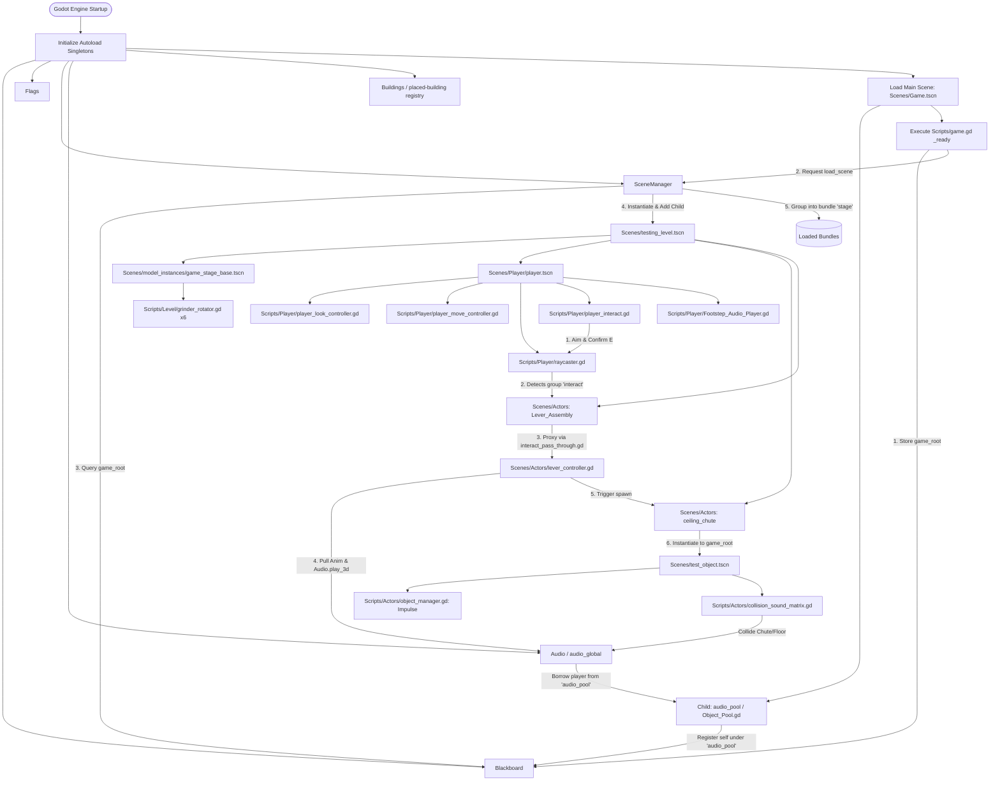

# Remnant GD

A modular, decoupled game architecture built on **Godot Engine 4.7 Forward+**, utilizing **Jolt Physics 3D** and **Direct3D 12**.

> [!TIP]
> **Interactive Documentation**: An offline-ready, searchable HTML wiki is available in [`.wiki/index.html`](.wiki/index.html). You can double-click it in your file explorer to open it immediately in any browser with instant search, dark/light theme toggle, and code copying.

---

## Architecture Overview

Remnant GD is built around decoupled global services, reactive state management, audio pooling, physical interaction raycasting, and modular character/environment controllers:



---

## Directory Structure

```
Remnant-GD/
├── Global/                                # Engine-wide singletons and shared models
│   ├── Blackboard.gd                      # Global key-value registry and service locator
│   ├── flag.gd                            # Reactive boolean Resource with signals
│   ├── Flags.gd                           # Global flag state manager
│   ├── scene_def.gd                       # Scene metadata model & node_type enum
│   ├── scene_manager.gd                   # Dynamic scene instancer & bundle manager
│   ├── audio_global.gd                    # Global spatial and stereo pooled audio dispatcher
│   └── building_registry.gd               # Buildings autoload, live registry and save snapshots
├── Scenes/                                # Game scene definitions (.tscn)
│   ├── Game.tscn                          # Main root entry scene (hosts audio_pool)
│   ├── testing_level.tscn                 # 3D sandbox testing stage with lighting & fog
│   ├── audio_player.tscn                  # Pooled audio player prefab (3D + Global)
│   ├── test_object.tscn                   # Physics prop with impulse & collision sound matrix
│   ├── Actors/                            # Interactive actor prefabs
│   │   ├── lever_assembly.tscn            # Interactive lever machine with lights & animations
│   │   ├── lever_controller.gd            # FSM controller for lever mechanics
│   │   └── score_object.tscn              # Reusable child score-value component
│   ├── Player/                            # Player actor scenes
│   │   └── player.tscn                    # CharacterBody3D with camera, look, move, raycast, audio
│   ├── Building/                          # Generic package, packed light, and placed work light
│   ├── UI/                                # Reusable prompt_label.tscn styling
│   └── model_instances/                   # Pre-composed environment & prop instances
│       ├── game_stage_base.tscn           # Instanced FBX level geometry with 6 grinder rollers
│       ├── lever.tscn                     # Lever handle mesh instance wrapper
│       └── lever_base.tscn                # Lever chassis mesh instance wrapper
├── Scripts/                               # Gameplay and subsystem scripts
│   ├── game.gd                            # Root bootstrap controller attached to Game.tscn
│   ├── interact_pass_through.gd           # Interaction proxy forwarding raycast calls
│   ├── Object_Pool.gd                     # Generic PackedScene recycling object pool
│   ├── Actors/                            # Actor subsystem components
│   │   ├── audio_player.gd                # Pooled dual 3D/global audio stream player
│   │   ├── ceiling_chute.gd               # Overhead item spawner parenting to game_root
│   │   ├── CollisionSoundEntry.gd         # Resource definition mapping groups to audio
│   │   ├── collision_sound_matrix.gd      # Contextual physics impact sound evaluator
│   │   ├── object_manager.gd              # Impulse launcher for physical props
│   │   └── score_object.gd                # Configurable points on a child Node
│   ├── Level/                             # Environmental logic & interactive hazards
│   │   ├── grinder_rotator.gd             # Continuous angular rotation component
│   │   └── grinding_area.gd               # Dropped-item destruction and Blackboard scoring
│   ├── Building/                          # Recipes, packed items, and registered placed buildings
│   ├── UI/                                # Prompt entries/sets, object components, labels, and display
│   └── Player/                            # Player mechanics
│       ├── player_look_controller.gd      # Smooth mouse-look with pitch clamping & escaping
│       ├── player_move_controller.gd      # Kinematic WASD locomotion with sprint scaling
│       ├── player_interact.gd             # Interaction input listener dispatching raycasts
│       ├── player_pickup.gd               # Pickup/drop, charged throwing, and item consumption
│       ├── player_building.gd             # Ghost placement, wheel rotation, and Q repacking
│       ├── raycaster.gd                   # Group-filtered 3D raycast targeting component
│       └── Footstep_Audio_Player.gd       # Positional 3D alternating footstep audio orchestrator
├── Data/                                  # Data-driven resources
│   ├── Building/light.tres                # Floor work light recipe and anchor/rotation settings
│   ├── Prompts/                           # Editable look-at, carrying, and placement hint resources
│   └── Collision Sounds/                  # Material impact sound profiles (.tres)
│       ├── chute_sound_collisions.tres    # Whoosh audio profiles for chute collisions
│       └── object_hit_floor.tres          # Clunk/impact audio profiles for floor collisions
├── Audio/                                 # Audio clips and sound banks
│   └── SFX/
│       ├── machine_run.wav                # Ambient industrial machinery loop
│       ├── grind.wav                      # Roller hazard grinding audio
│       ├── Chute Impacts/                 # 6 cinematic metal whoosh sound samples
│       ├── Footsteps/                     # 23 footstep samples (Footstep_L1..12, R1..11)
│       ├── item_hit_floor/                # 7 metal clunk and impact samples
│       └── Lever/                         # Lever_Pull.wav and Lever_Reset.wav
├── Models/                                # 3D assets, textures, materials, and FBX meshes
│   ├── Chute/                             # Overhead ceiling chute FBX models
│   ├── Lever/                             # Lever arm and base FBX models
│   └── Level/                             # Stage geometry and PBR materials
├── default_bus_layout.tres                # Audio Bus routing (Master -> Game_Master [Reverb] -> SFX)
├── .wiki/                                 # Searchable offline HTML Wiki (hidden from Godot)
│   ├── .gdignore                          # Engine ignore file
│   └── index.html                         # Single-file documentation portal with search
├── guide.txt                              # Maintenance guide and running log for AI agents
├── project.godot                          # Godot 4.7 project configuration
└── README.md                              # Repository documentation
```

> [!NOTE]
> Active autoload singletons in `project.godot` point directly to canonical scripts in `Global/`: `Blackboard`, `Flags`, `SceneManager`, `Audio`, and `Buildings`. Duplicate script files in the repository root are legacy copies.

---

## Systems & Subsystems Reference

### 1. Globals (`Global/`)

#### Blackboard (`Global/Blackboard.gd`)
- **Autoload Singleton**: `Blackboard`
- **Class Name**: `blackboard`
- **Inherits**: `Node`
- **UID**: `uid://b0xpvnyknnyk0`

Centralized key-value storage and service locator. Eliminates direct scene couplings.

##### Methods
| Method | Return Type | Description |
|---|---|---|
| `store_data(key: String, data: Variant)` | `void` | Stores or overwrites a value under `key`. |
| `read_data(key: String)` | `Variant` | Retrieves value for `key`, or returns `null`. |
| `data_exists(key: String)` | `bool` | Returns `true` if `key` exists in the blackboard. |
| `return_set(subkey: String)` | `Dictionary` | Returns all key-value pairs whose keys begin with `subkey`. |
| `remove_data(key: String)` | `void` | Deletes the entry under `key`. |

##### Code Example
```gdscript
# Register a global service or pool
Blackboard.store_data("game_root", self)
Blackboard.store_data("audio_pool", audio_pool_instance)

# Read from another system
var game_root = Blackboard.read_data("game_root")
var pool = Blackboard.read_data("audio_pool")
```

---

#### flag (`Global/flag.gd`)
- **Class Name**: `flag`
- **Inherits**: `Resource`
- **UID**: `uid://iv0r7qmbcuf`

An individual reactive boolean state resource that emits signals when changed.

##### Properties & Signals
- `state: bool = false`: Current state.
- `signal flag_set`: Emitted when `state` becomes `true`.
- `signal flag_unset`: Emitted when `state` becomes `false`.
- `set_state(val: bool)`: Updates state and emits the corresponding transition signal.

---

#### Flags (`Global/Flags.gd`)
- **Autoload Singleton**: `Flags`
- **Class Name**: `flags`
- **Inherits**: `Node`
- **UID**: `uid://cmu2qskbjdauq`

Global manager for storing, querying, and observing named boolean flags.

##### Methods
| Method | Return Type | Description |
|---|---|---|
| `set_flag(key: String, state: bool = true, connection_set: Array[Callable] = [], connection_unset: Array[Callable] = [])` | `void` | Sets flag, connects callbacks, and emits transition signal. |
| `check_flag(key: String)` | `bool` | Checks state; returns `false` if flag does not exist. |
| `remove_flag(key: String)` | `void` | Erases flag from storage. |
| `connect_to_flag(key: String, connection_set: Array[Callable] = [], connection_unset: Array[Callable] = [])` | `void` | Attaches listener Callables to transitions. |

---

#### scene_def (`Global/scene_def.gd`)
- **Class Name**: `scene_def`
- **Inherits**: `Resource`
- **UID**: `uid://dc5037qix867v`

Metadata class representing a loaded scene instance tracked by `SceneManager`.

##### Properties
- `name: StringName`: Unique scene identifier.
- `node: Node`: Instantiated node in the tree.
- `type: node_type`: Classification enum (`ui = 0`, `actor = 1`).
- `asset: PackedScene`: Source scene asset.

---

#### SceneManager (`Global/scene_manager.gd`)
- **Autoload Singleton**: `SceneManager`
- **Inherits**: `Node`
- **UID**: `uid://b0kybwgisrflw`

Global orchestrator for dynamic scene instancing, bundle grouping, parent resolution, and memory cleanup.

##### Methods
| Method | Return Type | Description |
|---|---|---|
| `load_scene(scn: PackedScene, access_name: StringName, bundle: StringName = "", parent: Node = null)` | `Node` | Instantiates `scn`, mounts to `parent` (or `Blackboard["game_root"]`), and registers in bundle or scene dictionary. |
| `unload_scene(access_name: StringName)` | `void` | Invokes `queue_free()` and clears references. |
| `get_scene(access_name: StringName)` | `Node` | Returns active `Node` by name. |
| `scene_exists(access_name: StringName)` | `bool` | Returns `true` if scene is loaded. |

---

#### audio_global (`Global/audio_global.gd`)
- **Autoload Singleton**: `Audio`
- **Class Name**: `audio_global`
- **Inherits**: `Node`
- **UID**: `uid://6htl8d4x7ugw`

Global sound dispatcher managing spatial 3D audio and non-spatial stereo audio via pooled `audio_player` instances.

##### Static Methods
| Method | Return Type | Description |
|---|---|---|
| `play_3d(stream: AudioStream, position: Vector3, volume: float = 1.0, pitch: float = 1.0, bus: StringName = &"Master")` | `void` | Borrows an `audio_player` from `Blackboard["audio_pool"]`, positions it, sets parameters, and plays 3D spatial stream. Recycles on finish. |
| `play_global(stream: AudioStream, volume: float = 1.0, pitch: float = 1.0, bus: StringName = &"Master")` | `void` | Borrows an `audio_player` and plays stream via non-positional stereo player. Recycles on finish. |
| `_on_audio_finished(pool: object_pool, audio: audio_player)` | `void` | Callback that returns the player back to the pool via `pool.release_object(audio)`. |

##### Code Example
```gdscript
# Triggering spatial 3D sound via Autoload singleton
Audio.play_3d(pull_sound, global_position, 1.0, 1.0, "SFX")

# Triggering via static class name
audio_global.play_3d(footstep_sample, foot_position, 0.8, 1.0, "SFX")
```

---

### 2. Scripts Subsystems (`Scripts/`)

#### Root: `Scripts/`

##### `game.gd`
- **Inherits**: `Node`
- **UID**: `uid://b4onouqptgpob`
- **Description**: Bootstrap controller attached to `Scenes/Game.tscn`. Registers `self` into `Blackboard` under `"game_root"` and requests `SceneManager.load_scene("res://Scenes/testing_level.tscn", "test_level", "stage")`.

##### `interact_pass_through.gd`
- **Inherits**: `Node`
- **UID**: `uid://b327fegnr3cah`
- **Description**: Interaction proxy component. When attached to collision shapes (such as `StaticBody3D` in group `"interact"`), it receives `interact()` calls from the player's raycast and forwards them to a configured `target` node.
- **Exported Properties**:
  - `@export var target: Node`: Target node receiving forwarded `interact()` invocations.

##### `Object_Pool.gd`
- **Class Name**: `object_pool`
- **Inherits**: `Node`
- **UID**: `uid://d0spk0ca82aid`
- **Description**: High-performance generic object pooling container. Pre-instantiates and recycles reusable `PackedScene` instances, avoiding garbage collection spikes.
- **Exported Properties**:
  - `@export var pooled_scene: PackedScene`: Scene asset to instantiate and pool.
  - `@export var initial_size: int = 0`: Pre-spawned instance count on ready.
  - `@export var reset_method: StringName = &""`: Optional cleanup method called upon release.
  - `@export var register_with_blackboard: bool = false`: If true, stores self in `Blackboard`.
  - `@export var blackboard_name: StringName = &""`: Key name for Blackboard storage.
- **Methods**:
  - `get_object() -> Node`: Pops available instance or creates a new one.
  - `release_object(object: Node) -> void`: Executes reset method and returns instance to pool.

---

#### Subfolder: `Scripts/Actors/`

##### `audio_player.gd`
- **Class Name**: `audio_player`
- **Inherits**: `Node3D`
- **UID**: `uid://jnf7npi534wc`
- **Description**: Pooled audio entity combining an `AudioStreamPlayer3D` and an `AudioStreamPlayer`.
- **Exported Properties**:
  - `@export var audio_3d: AudioStreamPlayer3D`: Positional 3D player.
  - `@export var audio_global: AudioStreamPlayer`: Non-positional stereo player.
- **Signals**: `playback_finished`
- **Methods**: `play_3d(...)`, `play_global(...)`, `stop()`, `reset()`.

##### `ceiling_chute.gd`
- **Class Name**: `ceiling_chute`
- **Inherits**: `Node3D`
- **UID**: `uid://di3swkqh5sn4a`
- **Description**: Overhead industrial chute spawner. Instantiates `test_actor` (configured as `test_object.tscn`) and parents it to `Blackboard["game_root"]` at `spawn_point.global_position`.
- **Exported Properties**:
  - `@export var spawn_point: Node3D`: Spawn marker transform.
  - `@export var test_actor: PackedScene`: Prefab scene to instantiate.

##### `CollisionSoundEntry.gd`
- **Class Name**: `collision_sound_entry`
- **Inherits**: `Resource`
- **UID**: `uid://ntd28sbuhvl7`
- **Description**: Data resource pairing target collision group names with sound banks and volume levels.
- **Exported Properties**:
  - `@export var name: StringName`: Identifier name.
  - `@export var group: StringName`: Target collision group name (e.g. `Chute`, `Floor`).
  - `@export_range(0.0, 1.0, 0.01) var volume: float = 1.0`: Volume scalar.
  - `@export var sounds: Array[AudioStream]`: Bank of randomized audio clips.

##### `collision_sound_matrix.gd`
- **Class Name**: `collision_sound_matrix`
- **Inherits**: `Node3D`
- **UID**: `uid://charfnmvsr4so`
- **Description**: Physics collision sound evaluator. When connected to `body_entered(other)`, it checks `other` against the configured `sound_matrix` array of `collision_sound_entry` resources and triggers 3D audio via `audio_global.play_3d()`.
- **Exported Properties**:
  - `@export var sound_matrix: Array[collision_sound_entry]`: Collection of collision sound profiles.

##### `object_manager.gd`
- **Class Name**: `object_manager`
- **Inherits**: `Node3D`
- **UID**: `uid://casxr53xeio0n`
- **Description**: Physics prop launch controller. During `_ready()`, applies a randomized 3D impulse scaled by `start_force` to its child `RigidBody3D`.
- **Exported Properties**:
  - `@export var rb: RigidBody3D`: Target rigid body.
  - `@export var start_force: float = 10.0`: Impulse magnitude.

##### `lever_controller.gd` (`Scenes/Actors/lever_controller.gd`)
- **Class Name**: `lever`
- **Inherits**: `Node3D`
- **UID**: `uid://hu82hspe070x`
- **Description**: FSM controller managing interactive lever mechanics (`0 = idle`, `1 = pull`, `2 = reset`), status indicator lights, animation tracks, 3D audio, and chute spawn triggers.
- **Exported Properties**:
  - `@export var anim: AnimationPlayer`: Animation player for lever rotation tracks.
  - `@export var chute: ceiling_chute`: Target chute triggered upon pull completion.
  - `@export var pull_sound: AudioStream`: Audio stream for lever pulling.
  - `@export var reset_sound: AudioStream`: Audio stream for lever resetting.
  - `@export var green_light: OmniLight3D`: Standby ready light (energy 1 when idle).
  - `@export var red_light: OmniLight3D`: Active cycle light (energy 1 when busy).

---

#### Subfolder: `Scripts/Level/`

##### `grinder_rotator.gd`
- **Inherits**: `Node3D`
- **UID**: `uid://bnrtinfng5v8l`
- **Description**: Continuous angular rotation component for rotating hazard rollers in `game_stage_base.tscn`.
- **Exported Properties**:
  - `@export var roation_speed: Vector3 = Vector3(0, 0, 0)`: Euler rotation velocity in deg/sec.

---

#### Subfolder: `Scripts/Player/`

##### `player_look_controller.gd`
- **Inherits**: `Node`
- **UID**: `uid://bu180f6gx5iet`
- **Description**: First-person mouse-look controller with separate head pitch and body yaw pivots, exponential smoothing, and pitch clamping.
- **Exported Properties**:
  - `Head: Node3D`: Camera pivot for pitch (X-axis).
  - `Body: Node3D`: Character body pivot for yaw (Y-axis).
  - `sensitivity: Vector2 = Vector2(0.08, 0.08)`: Mouse sensitivity factors.
  - `smoothness: float = 18.0`: Exponential lerp speed coefficient.
  - `clamp_look: Vector2 = Vector2(-89.0, 89.0)`: Min/max vertical pitch clamping.
  - `quit_key: Key = Key.KEY_ESCAPE`: Releases mouse capture to `MOUSE_MODE_VISIBLE`.

##### `player_move_controller.gd`
- **Inherits**: `Node`
- **UID**: `uid://bk5h65t12flbr`
- **Description**: Kinematic WASD locomotion controller. Computes direction relative to body orientation, manages acceleration and deceleration smoothing, scales by sprint multiplier, runs `move_and_slide()`, and drives the footstep sound player cadence.
- **Exported Properties**:
  - `move_speed: float = 10.0` (configured in player.tscn as `2.5`).
  - `sprint_speed_mult: float = 2.0`: Speed multiplier when holding `sprint` action.
  - `acceleration: float = 40.0`: Acceleration rate.
  - `deceleration: float = 40.0`: Deceleration rate.
  - `body: Node3D`: Body node providing forward/right basis.
  - `character_body: CharacterBody3D`: Target player CharacterBody3D.
  - `footstep_player: footstep_audio`: Reference to footstep player component.

##### `player_interact.gd`
- **Class Name**: `player_interact`
- **Inherits**: `Node`
- **UID**: `uid://dhx0pwxpcthco`
- **Description**: Player interaction dispatcher. Listens for the `confirm` input action (E key release), checks if `raycaster` is aiming at a valid target, and invokes `interact()` on that target.
- **Exported Properties**:
  - `@export var ray: raycaster`: Reference to camera raycaster.

##### `raycaster.gd`
- **Class Name**: `raycaster`
- **Inherits**: `RayCast3D`
- **UID**: `uid://dopt5ybemmifn`
- **Description**: Group-filtered first-person RayCast3D targeting system. Tracks hovered target nodes within reachable distance that belong to whitelisted groups (e.g. `&"interact"`).
- **Exported Properties**:
  - `@export var ray_distance: float = 3.0`: Maximum reach distance in meters.
  - `@export var target_groups: Array[StringName] = []`: Whitelisted group names.

##### `Footstep_Audio_Player.gd`
- **Class Name**: `footstep_audio`
- **Inherits**: `Node3D`
- **UID**: `uid://dnnbhrne61at7`
- **Description**: Timer-driven alternating positional 3D footstep sound orchestrator. Dispatches audio clips via `audio_global.play_3d()` and supports walk and sprint pacing intervals.
- **Exported Properties**:
  - `right_foot_sounds: Array[AudioStream]`: 11 right foot audio streams.
  - `left_foot_sounds: Array[AudioStream]`: 12 left foot audio streams.
  - `left_player: Node3D`: Left foot marker transform (offset x = -0.88m).
  - `right_player: Node3D`: Right foot marker transform (offset x = +0.47m).
  - `footstep_timer: Timer`: Cadence timer.
  - `sprint_timer: float = 0.25`: Cadence interval while sprinting.
  - `walk_timer: float = 0.5`: Cadence interval while walking.
  - `volume: float = 1.0`, `pitch: float = 1.0`, `bus: StringName = &"Master"`.
  - `enabled: bool = false`: Playback active toggle.

---

### 3. Scenes Reference (`Scenes/`)

- **`Scenes/Game.tscn`** (`uid://dcrox1fn8bvwe`):
  - Root node running `Scripts/game.gd`.
  - Child node `audio_pool` running `Scripts/Object_Pool.gd`, registered to Blackboard as `"audio_pool"`.
- **`Scenes/testing_level.tscn`** (`uid://blbs2kyd6bds2`):
  - 3D test stage featuring `WorldEnvironment` (SSAO + Volumetric Fog density 0.0634).
  - Ambient 3D audio `MachineRun` on SFX bus.
  - Instantiates `game_stage_base.tscn`, `player.tscn`, `ceiling_chute`, and `Lever_Assembly`.
- **`Scenes/Player/player.tscn`** (`uid://ci3oy7ni8sysi`):
  - `CharacterBody3D` with `CapsuleShape3D` collider.
  - `Camera3D` equipped with `SpotLight3D` flashlight and `RayCast3D` running `raycaster.gd`.
  - `footstep_sound_players` running `Footstep_Audio_Player.gd` with 23 footstep streams.
  - `Controllers` node housing `Player_Look_Controller`, `Player_Move_Controller`, and `Player_Interact`.
- **`Scenes/model_instances/game_stage_base.tscn`** (`uid://da63abf1yef55`):
  - Instanced from `Models/Level/game_stage_base.fbx`.
  - Configures 6 rotating grinder rollers with alternating rotation speeds (`-25` and `+25` deg/s) running `grinder_rotator.gd`.
- **`Scenes/Actors/lever_assembly.tscn`** (`uid://x4o8rin8xvjo`):
  - Complete interactive lever apparatus with FBX model meshes, green/red status indicator lights, `AnimationPlayer`, and a `StaticBody3D` collision volume running `interact_pass_through.gd` in group `"interact"`.
- **`Scenes/audio_player.tscn`** (`uid://drn170duudujd`):
  - Pooled audio emitter entity running `audio_player.gd`, housing an `AudioStreamPlayer3D` and an `AudioStreamPlayer`.
- **`Scenes/test_object.tscn`** (`uid://0851ilsmei5g`):
  - Interactive physics prop spawned by the ceiling chute. Runs `object_manager.gd` on root and `collision_sound_matrix.gd` on child `RigidBody3D` with continuous collision detection and chute/floor audio profiles.

---

### 4. Audio Routing Architecture & Data Profiles

#### Audio Bus Hierarchy (`default_bus_layout.tres`)
1. **`Master` (Bus 0)**: Direct output to physical hardware speakers.
2. **`Game_Master` (Bus 1)**: Routes into `Master`. Contains an active `AudioEffectReverb` effect applying room resonance to the entire scene.
3. **`SFX` (Bus 2)**: Routes into `Game_Master`. Carries all sound effects (footsteps, machines, levers, collisions), naturally receiving environmental reverb.

#### Data Profiles (`Data/Collision Sounds/`)
- **`chute_sound_collisions.tres`** (`uid://ca8v04uj6idly`): `collision_sound_entry` for group `&"Chute"` at volume `0.5`, containing 6 cinematic metal whoosh sound samples.
- **`object_hit_floor.tres`** (`uid://cemrs3dv756c8`): `collision_sound_entry` for group `&"Floor"` at volume `1.0`, containing 7 metal clunk and impact sound samples.

---

## Building System (`Scripts/Building/`)

The test level includes a packed work light beside the player's starting position (`1.6, 0.5, -0.5`). Pick it up with **F** and carry the visible crate normally. Press **B** to hide the crate and show its building ghost, aim at a floor within **8 metres**, rotate with the **mouse wheel**, and press **B again** to place. Green ghosts are valid; red ghosts are blocked or on an unsupported surface. An invalid second B press leaves placement active so you can adjust and retry. Aim at a placed building within the player's **3 metre** interaction range and release **Q** with empty hands to return it directly to a visible held package in carrying mode. **F cancels placement back to carrying**, keeping the crate in hand and restoring its visibility. In carrying mode F drops the crate and right mouse charges/throws it. Throw input is suppressed during placement. **E** remains the ordinary interaction key.

The light is a directional work light, so rotating it changes where it shines. Its base marker snaps to the aimed floor point with a 0.01 metre clearance. Placement accepts the `Floor` group, rejects slopes above 15 degrees, and checks the light's collision footprint against other bodies, including the player. Ghosts have translucent materials, no gameplay scripts, no collision layers, no audio, and no active lights. They never enter the save registry.

### Building files and metadata

| File | Class / autoload | Inherits | UID |
|---|---|---|---|
| `Global/building_registry.gd` | `Buildings` autoload (no class_name) | Node | `uid://bkx4k3sdfa02k` |
| `Scripts/Building/buildable_definition.gd` | `buildable_definition` | Resource | `uid://dlem4bamrroli` |
| `Scripts/Building/packed_buildable.gd` | `packed_buildable` | RigidBody3D | `uid://bdipyvcg31bb0` |
| `Scripts/Building/buildable.gd` | `buildable` | StaticBody3D | `uid://cevw167f7deqy` |
| `Scripts/Player/player_building.gd` | `player_building` | Node | `uid://cn7o6qrvr8b7w` |
| `Scripts/Player/player_pickup.gd` | `player_pickup` | Node | `uid://2t6n5cae53ei` |

`Scenes/Building/packed_buildable.tscn` is a generic physics package. `Scenes/Building/packed_light.tscn` inherits it and assigns `Data/Building/light.tres`. That resource references `Scenes/Building/light.tscn` and the generic package. The generic package does not reference the resource, avoiding a circular scene/resource dependency. The player scene wires `Player_Building` to pickup, camera, and raycaster; the raycaster includes the `building` group. `Player_Building` handles the `build` input action (B press) for both entering placement and committing a building. `player_interact.gd` handles ordinary E interaction and blocks it while holding any item.

### `buildable_definition.gd`: recipes and anchors

Each recipe provides the placement rules independently of the player controller. Floor placement is the initial policy; pipe/conveyor connector matching is future work.

| Variable | Default | Purpose |
|---|---|---|
| `id` | empty StringName | Stable recipe identifier (`work_light` in the sample). |
| `building_scene` | null | Scene whose root uses `buildable.gd`. |
| `packed_scene` | null | Scene whose root uses `packed_buildable.gd`; definition is assigned when unbuilding. |
| `preview_scene` | null | Optional alternative ghost, otherwise the building scene is used. Must share the anchor and collision footprint. |
| `look_prompts` | null | Prompt set shown when aiming at this recipe's packed crate, including generic packages returned by Q. |
| `anchor_path` | `Anchor` | Marker path relative to the building/preview root. Its position is placed on the surface after rotation. |
| `surface_groups` | `[Floor]` | Allowed collider or ancestor groups; an empty array allows any group. |
| `maximum_slope_degrees` | 15 | Maximum surface slope relative to world up. |
| `align_to_surface` | true | Align the building's up direction to the surface normal. |
| `surface_offset` | 0.01 | Clearance above the hit surface. |
| `placement_distance` | 8 | Maximum placement ray distance in metres. |
| `placement_mask` | 1 | Physics layers used for surface rays and overlap validation. |
| `rotation_axis` | Vector3.UP | Normalized local rotation axis; zero falls back to up. |
| `rotation_step_degrees` | 15 | Rotation for each mouse wheel tick. |

`accepts_surface(collider: Node, normal: Vector3) -> bool` checks slope and walks collider ancestors to find an allowed group. No custom signals.

```gdscript
# Create an external .tres recipe in the Inspector and configure these fields.
var recipe: buildable_definition = load("res://Data/Building/light.tres")
print(recipe.anchor_path, recipe.rotation_axis)
```

### `packed_buildable.gd` and `buildable.gd`: item lifecycle

`packed_buildable.definition` stores the recipe. `_ready()` adds `pick-up`, so the existing pickup controller can hold, drop, or throw it. A missing definition produces a warning and prevents placement. No custom signals or other public methods.

`buildable.definition` retains the recipe after placement; `save_id` is a generated instance identifier that a future loader may assign before entering the tree. `_ready()` adds `building` and registers with `Buildings` when a definition exists. `_exit_tree()` unregisters on removal. `get_save_data() -> Dictionary` returns JSON-compatible values: save ID, external definition resource path, recipe ID, global position (3 numbers), and global basis (9 numbers preserving rotation and scale). No custom signals.

```gdscript
# Assign the definition before adding an authored building to the world.
var recipe: buildable_definition = load("res://Data/Building/light.tres")
var light: buildable = recipe.building_scene.instantiate()
light.definition = recipe
Blackboard.read_data("game_root").add_child(light)
```

### `building_registry.gd`: global save registry

The `Buildings` autoload initializes after `Blackboard` and exposes the same mutable `Array[buildable]` at `Blackboard["buildables"]`. It contains placed instances only. Packages and ghosts are excluded, repeated registration is ignored, and unbuilding removes an entry immediately before freeing its node.

| Method | Return | Purpose |
|---|---|---|
| `register_building(building: buildable)` | void | Append if not already registered. |
| `unregister_building(building: buildable)` | void | Remove the instance; safe to call repeatedly. |
| `get_save_data()` | Array[Dictionary] | Snapshot valid, nonqueued buildings into serializable records. |

State: `buildables: Array[buildable] = []`. No custom signals. This implements the registry and serialization snapshot; saving/loading files is not yet implemented. Author definitions as external `.tres` resources so their paths can be resolved by a future loader.

```gdscript
var placed: Array = Blackboard.read_data("buildables")
var save_json: String = JSON.stringify(Buildings.get_save_data())
```

### `player_building.gd`: preview and placement controller

| State / reference | Purpose |
|---|---|
| `pickup`, `camera`, `ray` | Exported controller references wired in `player.tscn`. |
| `valid_color`, `invalid_color` | Exported translucent green/red ghost colors. |
| `package`, `definition`, `preview` | Current held package, its recipe, and preview node. |
| `placement_valid`, `rotation_angle` | Current clearance result and wheel rotation in radians. |
| `anchor_position`, `original_basis` | Preview-local anchor offset and authored root basis. |
| `preview_material`, `preview_shapes` | Unique material and cached collision footprint. |
| `package_hidden`, `package_original_visible` | Placement visibility override and original crate visibility restored when placement ends. |

| Method | Return | Purpose |
|---|---|---|
| `is_building()` | bool | Whether a held package has a live preview. |
| `start_building()` | bool | Enter placement from carrying mode: create/validate the ghost, save and hide crate visibility, and update aim. Returns false without hiding the crate when references/preview configuration are invalid. |
| `cancel_building()` | bool | Clear placement and restore visible carrying without dropping the package; false if placement is inactive. |
| `try_build()` | bool | Recheck aim and clearance, instantiate/register a building at the ghost transform, consume the package, and clear the ghost. Returns false without consuming on invalid placement/configuration. |
| `try_unbuild()` | bool | With empty hands, find a targeted building, create its package, hand it to pickup, and remove the building. Returns false if references, recipe, target, or package are invalid. |

The physics update tracks the held package without automatically starting a preview. The first B press calls `start_building()`; the next B press calls `try_build()`. Wheel events change recipe-local rotation only during placement. Placement rays exclude the player and every collision object in the held package hierarchy; clearance excludes the same package hierarchy while retaining the player. This includes static bodies generated inside imported models. Unsupported hits show red, missing hits hide the ghost. Dropping, throwing, consuming, changing packages, or removing the controller clears the preview and restores the crate's original visibility. Build transforms are converted into parent space before entering the scene tree, so a transformed `game_root` is supported. No custom signals.

```gdscript
# B starts placement or commits it; Q returns a building to carrying mode.
var controller: player_building = $Player/Controllers/Player_Building
if controller.is_building():
    controller.try_build()
```

### Pickup API additions (`Scripts/Player/`)

`player_pickup.gd` now exposes `pickup_object(target: RigidBody3D) -> bool` to receive a package directly, returning false if hands are occupied or the hold reference/target is invalid. Raycast pickup delegates to the same method. `consume_held_object(expected: RigidBody3D) -> bool` clears holding, throw charge, and collision exceptions and frees exactly the expected package; false leaves the held object alone. The existing movement, freeze restoration, F toggle, and charged right-mouse throw behavior are retained. No custom signals.

Held items have collision layers and masks disabled for their entire `CollisionObject3D` hierarchy, including imported nested bodies and areas. `held_collision_state: Array[Dictionary]` snapshots each collider and its original layer/mask. Drop, throw, and consumption restore those settings and clear the snapshot; freed descendants are safely skipped. `get_held_collision_rids() -> Array[RID]` supplies every live held collider to the building controller's ray and clearance exclusions. This prevents carried crates from pushing the player or becoming placement surfaces.

The exported `building` reference points at `Player_Building`. F release calls `cancel_building()` when placement is active, retaining the held crate; otherwise it keeps the normal pickup/drop toggle. Throw input is suppressed during placement. `cancel_throw_charge() -> void` clears any pending throw when placement begins so an old charge cannot leak into carrying mode.

### Adding another building

1. Create a scene with a `StaticBody3D` root using `buildable.gd`, visible geometry, collision shapes describing its clearance footprint, and an `Anchor` marker.
2. Create an external `buildable_definition` `.tres`, assign its building and generic package scenes, and configure anchor, surface groups, slope, distance, physics mask, local rotation axis, and step.
3. Create an inherited package scene and assign that definition. Place the package in the level.
4. For an optional separate ghost scene, use the same anchor and matching collision footprint. Scripts are stripped before preview nodes enter the tree; gameplay code never runs on ghosts.
5. Add matching wiki/README documentation and a guide log entry.

### Validation

Run `godot --headless --path . Tests/building_system_test.tscn`. The integration scene checks F-compatible visible carrying, first-B crate hiding and ghost activation, second-B placement, E remaining interaction-only, invalid-B retries, ghost isolation, wheel rotation, floor anchoring, transformed parents, active light placement, registry/JSON records, Q returning to carrying mode, rebuild cycles, external deletion, obstruction rejection, slope/group rules, nonzero anchors, configurable axes, missing hits, drop/throw visibility cleanup, and ordinary prop pickup/throw regression.

The collision regression also checks imported and synthetic nested crate bodies, player overlap with the character kept active in Jolt, floor aiming through a held crate, hierarchy-wide RID exclusions even with collision layers enabled, exact drop/throw layer-mask restoration, and repeated pickup without snapshot accumulation.

## Dynamic Look-at Prompts (`Scripts/UI/`)

The testing level's existing `Prompt_Container/HBoxContainer` now uses `prompt_display.gd`. Its spacing/layout is retained; placeholder labels are replaced with instances of `Scenes/UI/prompt_label.tscn`. Every hint uses this reusable Label scene, so font, outline, color, alignment, and child visuals can be edited in one place. The display and label ignore mouse input.

| Context | Prompts |
|---|---|
| Looking at the lever | `Pull Lever [E]` |
| Looking at the light crate | `Pickup Light [F]` |
| Looking at a test object | `Pickup Strange Object [F]` |
| Carrying a crate | `[F] Drop` / `[RMB] Throw` / `[B] Build` |
| Placing a building | `[B] Place` / `[F] Cancel` |
| Carrying an ordinary object | `[F] Drop` / `[RMB] Throw` |
| Looking at a placed light | `Unbuild [Q]` |
| No target and empty hands | Hidden |

Placement prompts have priority over carrying prompts, which have priority over look-at prompts. Keys are read from the action's current InputMap binding; rebinding an action updates the hint. Resource edits update dynamically without changing UI scripts. The player raycaster's debugging is disabled in `player.tscn`.

### Prompt script metadata

| File | Class | Inherits | UID |
|---|---|---|---|
| `Scripts/UI/prompt_entry.gd` | `prompt_entry` | Resource | `uid://lojqp4d1v7g4` |
| `Scripts/UI/prompt_set.gd` | `prompt_set` | Resource | `uid://bemke5wgfbexu` |
| `Scripts/UI/object_prompts.gd` | `object_prompts` | Node | `uid://0ojj3a5mwcai` |
| `Scripts/UI/prompt_label.gd` | `prompt_label` | Label | `uid://b43gj5mlpu3xp` |
| `Scripts/UI/prompt_display.gd` | `prompt_display` | HBoxContainer | `uid://dydvfnp1pg6a4` |

No prompt script defines custom signals; the display samples the current target/player state each frame and only changes labels when their displayed text changes.

### Prompt entries and sets

`prompt_entry` describes a hint independently of UI presentation. `prompt_set` is an ordered reusable resource holding `entries: Array[prompt_entry] = []`. Null entries are skipped.

| Entry variable | Default | Purpose |
|---|---|---|
| `text: String` | empty | Action wording, e.g. `Pull Lever`. |
| `action: StringName` | empty | InputMap action, e.g. `confirm`, `pickup`, `build`, `throw`, or `unbuild`. |
| `key_first: bool` | false | False formats `Pull Lever [E]`; true formats `[F] Drop`. |
| `key_override: String` | empty | Optional fixed display label; otherwise use the action's first supported keyboard/mouse binding. |

`get_display_text() -> String` renders the entry. Missing actions/bindings yield text without a key suffix. Mouse hints use `LMB`, `RMB`, and `MMB`; keyboard hints use physical keycodes when available. `prompt_set` has no public methods.

```gdscript
var entry := prompt_entry.new()
entry.text = "Use Machine"
entry.action = &"confirm"
var hints := prompt_set.new()
hints.entries.append(entry)
```

### `object_prompts.gd`: configuring object hints

Add a Node using this script under a collider or one of its ancestors, then assign its exported `prompts: prompt_set`. `_ready()` adds a Node3D owner to `look-prompt`, which is included in the player raycaster's target groups. Existing interaction/pickup scripts remain separate. `find_for(target: Node) -> object_prompts` walks the looked-at node and its ancestors, finding the nearest child component. `get_prompts() -> prompt_set` returns the configured resource; an unconfigured component directly below a `packed_buildable` falls back to `definition.look_prompts`. Other unconfigured components return null.

The lever and test object carry configured components in their prefabs. The generic package has a fallback component, so both the initial crate and a package returned by unbuilding show the recipe's pickup hint. The light scene provides an Unbuild hint.

```gdscript
var component := object_prompts.new()
component.prompts = load("res://Data/Prompts/pull_lever.tres")
$Machine.add_child(component)
```

### `prompt_label.gd`: reusable label presentation

`set_prompt(entry: prompt_entry) -> void` assigns `entry.get_display_text()` to the inherited Label text. No custom state or signals. Edit `Scenes/UI/prompt_label.tscn` to change all hint styling; the default is white 22px text with a dark outline.

```gdscript
var label: prompt_label = load("res://Scenes/UI/prompt_label.tscn").instantiate()
$HBoxContainer.add_child(label)
label.set_prompt(load("res://Data/Prompts/pull_lever.tres").entries[0])
```

### `prompt_display.gd`: state priority and label reuse

| Variable | Purpose |
|---|---|
| `ray`, `pickup`, `building` | Exported player references assigned on the level HBoxContainer. |
| `label_scene` | Exported PackedScene using `prompt_label.gd`. |
| `carrying_prompts` | Exported generic held-object prompt set. |
| `carrying_buildable_prompts` | Exported held-crate prompt set including Build. |
| `placement_prompts` | Exported active-placement prompt set. |
| `labels: Array[prompt_label]` | Current reusable label instances. |
| `displayed_texts: Array[String]` | Cached formatted hints used to avoid unnecessary UI changes. |

`get_current_prompts() -> prompt_set` selects placement, carried crate, ordinary carried object, or nearest looked-at component. `refresh() -> void` updates text, reuses existing labels, adds/removes instances to match the entry count, and hides the row when empty. Missing/wrong label scenes produce a warning; unknown/freed targets produce an empty row. `_process()` calls `refresh()` automatically.

```gdscript
var display: prompt_display = $Prompt_Container/HBoxContainer
display.placement_prompts = load("res://Data/Prompts/placement.tres")
display.refresh()
```

### Editing and extending prompts

All default text is in `Data/Prompts/`: `pull_lever.tres`, `pickup_light.tres`, `pickup_strange_object.tres`, `carrying.tres`, `carrying_buildable.tres`, `placement.tres`, and `unbuild.tres`. Add entries to a prompt set in the Inspector to show multiple hints in order. Assign sets to object components, building recipes, or the display's state slots. Add an `object_prompts` component to a new object to make it targetable and configurable without hardcoded names in the UI controller.

Run `godot --headless --path . Tests/prompt_system_test.tscn`. It loads the actual testing level and verifies scene references, all requested wording, ancestor component resolution, carrying/placement priority, F cancel versus drop, RMB suppression during placement, label reuse, runtime configuration edits, key rebinding, repacked crate hints, freed targets, arbitrary prompt-only objects, viewport bounds, and disabled raycast debugging. The building regression suite also continues to pass. Reusable label styling has been rendered and visually inspected.

## Grinding and Score

The existing `grinding_area` Area3D in `testing_level.tscn` uses `Scripts/Level/grinding_area.gd`. Its authored volume/position is preserved, monitoring is enabled, and `body_entered` drives item destruction. It has collision layer 0 and retains its detection mask (default layer 1). Use its collision mask to select additional item physics layers.

Loose rigid-body items are destroyed on entry, including crates whose imported child StaticBody3D collider enters first. Characters and ordinary static scenery are ignored. To remove a wrapper together with its physics body, put the wrapper root in `grindable` or `score`. The test-object prefab root is now `grindable`, so grinding its RigidBody3D also removes its object manager and prompts. A bare RigidBody3D needs no group to be destroyed. The enclosing level/game root is never inferred as an item owner.

Items in the **`score` group** increase `Blackboard["score"]`. An optional child `score_object` supplies the amount; without one, the amount is **1**. A component alone does not make an item score: mark the item's body or logical wrapper root with `score`. Unmarked items are destroyed without points. The grinder initializes a missing score to 0, preserves an existing numeric total, and adds the amount before queuing deletion. The queued item-root check prevents double scoring across multiple colliders or grinder callbacks before deletion.

### `score_object.gd`: configurable child points

| Metadata | Value |
|---|---|
| File | `Scripts/Actors/score_object.gd` |
| Class / inheritance | `score_object` / Node |
| UID | `uid://c4fll2k7fsfr8` |
| Reusable scene | `Scenes/Actors/score_object.tscn` |
| Autoload | None |
| State | Exported `score: int = 1` |
| Signals / methods | No custom signals or methods. |

Add the reusable scene as a child of the item and set its **Score** property in the Inspector. A Node using this script works equally well. The grinder prefers a direct child component, then searches within that item's descendants, so components below a physics/model wrapper are supported. Zero values are honored. When multiple components exist, the first matching component supplies the amount; values are not summed.

```gdscript
# Enable scoring and give an item a custom value.
item.add_to_group("score")
var value: score_object = load("res://Scenes/Actors/score_object.tscn").instantiate()
value.score = 5
item.add_child(value)
```

### `grinding_area.gd`: item destruction and score accumulation

| Metadata | Value |
|---|---|
| File | `Scripts/Level/grinding_area.gd` |
| Class / inheritance | `grinding_area` / Area3D |
| UID | `uid://bcxrh405f124t` |
| Autoload | None |
| Persistent script state | None; the total is kept in Blackboard. |
| Inherited state | `monitoring`, `collision_layer`, and `collision_mask` control detection. |
| Signals | Uses inherited `body_entered`; no custom signals. |

`grind(body: Node3D) -> bool` processes an entering physics body, finds its enclosing RigidBody3D and optional marked wrapper, checks score-group membership between the entering collider and item root, enqueues the positive child value/default with ScoreRewards, plays grind audio, and queues the complete item for deletion. It returns true when an item is accepted and false for invalid bodies, static scenery, characters, or items already queued for deletion. Nested static colliders inside a rigid item are accepted; unrelated static bodies are not. The area connects this method to `body_entered` in `_ready()` without duplicate connections.

`_find_rigid_body`, `_find_item_root`, `_is_scoring_item`, and `_find_score_object` are private resolution helpers. Temporary variables hold the rigid body, logical item root, optional component, and amount. ScoreRewards awards points at accelerating intervals and flushes the remainder when its delay reaches zero. Held items retain the existing disabled-collider behavior and become detectable again when dropped/thrown.

```gdscript
# Read the user's accumulated score from another system.
var total: Variant = Blackboard.read_data("score")
# Normal gameplay uses Area3D.body_entered automatically.
$grinding_area.grind(dropped_body)
```

Run `godot --headless --path . Tests/grinding_system_test.tscn`. It checks score initialization/preservation, unmarked destruction, default/custom/zero values, component-only non-scoring, duplicate events, multi-body wrapper cleanup, imported crate colliders, player/scenery exclusion, real Area3D entry signals, and the saved level/prefab wiring. Building and prompt integration suites also pass.

## Score Sign and Loose Crate Physics

`Scenes/Actors/score_sign.tscn` uses `Scripts/Actors/score_sign.gd` on its Label3D. The sign reads `Blackboard["score"]` each frame and only changes its text when the formatted value changes. Missing/nonnumeric scores display zero. The default is eighteen digits, matching the authored sign; change **Minimum Digits** on its Label3D to choose another width. Leading zeros pad short scores, larger scores are never truncated, and negative values keep their minus sign.

The label aligns left and grows to the right. On startup it shifts the text offset by half the authored centered text width, preserving the existing left edge and the sign's model, lighting, and placement.

`score_sign` inherits Label3D, has no custom signals or autoload, and exports `minimum_digits: int = 18` (editor range 1–32). `_displayed_text: String` caches the last output. `_ready()` sets alignment/offset and refreshes immediately; `_process(delta)` calls `update_score()`, which can also be called explicitly after changing score or digit count. The script uses inherited `text`, `font`, `font_size`, `offset`, and `horizontal_alignment`.

```gdscript
Blackboard.store_data("score", 27)
# The default sign automatically displays 000000000000000027.
$"Score Sign/Label3D".minimum_digits = 6
$"Score Sign/Label3D".update_score() # 000027
```

Packed buildings remain unfrozen ordinary RigidBody3D objects while loose. `packed_buildable._ready()` recursively disables descendant PhysicsBody3D collision layers/masks through `_disable_imported_colliders(parent: Node)`, leaving the root rigid collider active. Imported crate static colliders otherwise push against the enclosing rigid body and cause spontaneous motion/spinning. Author collision shapes directly under the packed rigid body; imported model bodies are visual-only. Pickup/drop/throw retain their existing collision snapshot behavior; angular motion from actual impacts remains normal physics.

Run `godot --headless --path . Tests/score_sign_test.tscn` for live score updates, zero padding, configurable width, overflow, negative scores, imported collider suppression, and spontaneous-spin regression checks. Building, prompt, and grinding integration suites also pass.

## Queued Score Rewards and Grinding Audio

`ScoreRewards` is an autoload using `Global/score_rewards.gd` (Node, UID `uid://bs0i77t3jtdef`, no custom signals). `enqueue(amount: int)` adds positive item rewards to a shared queue. The first award is immediate. The starting delay is 0.5 seconds and decreases by 0.02 after each award: waits are 0.48, 0.46, 0.44 seconds, and so on. Each normal award adds 1 to `Blackboard["score"]` and plays loud `Audio/SFX/Score.wav` through pooled global SFX playback. New items extend the pending queue without resetting acceleration.

When the reduced delay reaches zero or below (with a tiny floating-point tolerance), all remaining points are added in one Blackboard update with one score sound. When the queue empties normally or by this batch, the timer stops, its elapsed-time guard clears, and the delay resets to 0.5. The next queue starts immediately at the base speed. Zero/negative rewards are ignored. Queued rewards survive deletion of source items/areas; the timer pauses with the scene tree.

Exports: `score_sound: AudioStream`, `score_volume: float = 2.0` (linear, about +6 dB), `point_interval: float = 0.5` (base delay), and `interval_decrease: float = 0.02`. `pending_points: int` is the remaining count. `_current_interval: float` stores the accelerating delay, `_timer: Timer` is a one-shot timer, and `_next_point_time_usec: int` prevents early timer delivery from skipping the selected delay. `_ready()` sets up the timer. `_award_next_point()` reduces the delay, selects one point or the entire remaining batch, updates the total (missing/nonnumeric means zero), plays audio once and schedules the next delay or resets on completion.

`grinding_area.grind()` destroys accepted items immediately and plays `Audio/SFX/grind.wav` once through pooled global SFX, including unscored items. Its exported `grind_sound: AudioStream` and `grind_volume: float = 1.0` are editable on the area. Score-group items enqueue their child score value or default 1. Duplicate queued-root events replay neither sound nor reward. The score sign reflects every normal award and the final batch.

`Global/audio_global.gd` uses `Blackboard.read_data("audio_pool")` in `play_global()`. Standard pooled audio_player playback sets stream, linear volume, pitch and SFX bus, then returns the player on completion.

```gdscript
ScoreRewards.enqueue(5) # Immediate point, then shorter waits per point.
ScoreRewards.enqueue(100) # Extend the queue; flush the rest at zero delay.
```

`Tests/score_rewards_test.tscn` checks decreasing delays, mid-count extension, batch completion at zero/negative delay, reset after normal/batch completion, duplicate suppression, sound counts, loud SFX routing, real pooled playback and return. The grinding suite checks complete queued totals separately.

## Agent Maintenance Protocol

For future AI agents modifying this repository:
1. Always keep the interactive HTML wiki at [`.wiki/index.html`](.wiki/index.html) synchronized with codebase changes.
2. Ensure the top category in the wiki navigation remains **Globals**, followed by subcategories corresponding to subfolders in `Scripts/` (such as `Actors`, `Level`, `Player`).
3. Keep the wiki 100% self-contained (no external CDN dependencies).
4. Update `README.md` to reflect new or modified systems.
5. Append every change to the running log in [`guide.txt`](guide.txt) using the format:
   `[YYYY-MM-DD][HH:MM:SS] - updated the guide to include '<script_or_feature>'`
